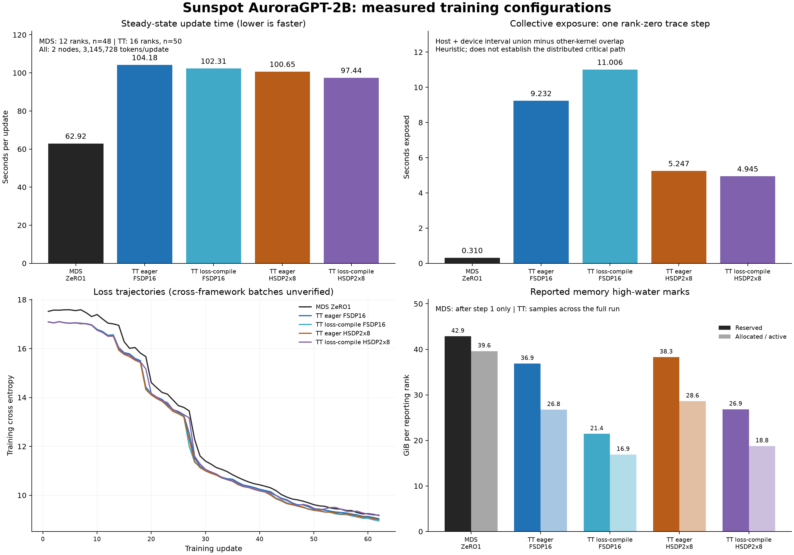

# AuroraGPT-2B: TorchTitan and Megatron-DeepSpeed on Sunspot

The new `Megatron-DeepSpeed` baseline, job `12481353`, completed all 62 updates with PBS/application exit `0`, a final checkpoint, and online `W&B`. It averaged **62.922 s/update**, versus **97.437 s/update** for the fastest measured `TorchTitan` arm, loss-compiled `HSDP2x8`. Both used two Sunspot nodes. This is **1.549x** the total token throughput for the executed configurations. Runtime, rank layout, attention implementation, and activation rematerialization differ.

The [2026-10-24 trace diagnosis](2026-10-24-zero1-hsdp-diagnosis.md) finds about `29.901 s` of extra non-oneCCL kernel-busy coverage and `4.635 s` of extra exposed collective time in the sampled compiled-HSDP step. TT uses math attention and full rematerialization; MDS uses fused efficient attention and no rematerialization. The MDS module also resets `FLAT` to `COMPOSITE` after the launcher export, while TT reasserts FLAT after module setup. Exact physical device equivalence is unverified.

The `TorchTitan` compile setting covers `components=["loss"]`. Full model compilation has not been measured here. Its eager/compiled loss histories fail the project's bitwise agreement requirement. Cross-framework numerical agreement remains unverified.

## Executed configuration

| Setting | `Megatron-DeepSpeed` | `TorchTitan` |
|---|---|---|
| Source HEAD | `b5617bac7b4e2303e738ef7db0307915da905941` plus archived scratch XPU-profiler patch | `5be47f7cfa12cb47d4a774480fe9251fe1e53ff8` |
| Runtime | `torch 2.10.0a0+git449b176`, `DeepSpeed 0.18.5`, oneAPI `2025.3.1` | `torch 2.14.0+xpu`, `xpu-torch214-fixedlr-v2-20260927` |
| Allocation and ranks | 2 Sunspot nodes, 12 ranks, 6 per node | 2 Sunspot nodes, 16 ranks, 8 per node |
| Device hierarchy | `COMPOSITE` after oneAPI module overrides the earlier FLAT export; six visible devices/node | `FLAT` after setup; twelve ~64-GiB devices/node, eight used |
| Parallelism | `ZeRO1`, TP1/PP1 | `FSDP16` or `HSDP2x8`, TP1/PP1 |
| Model | 12 layers, hidden 2048, 16 Q heads / 4 KV heads, FFN 11008, vocab 256000, RoPE theta 50000 | `2b-mds`, same configured dimensions |
| Initial weights | Native `global_step138650`, model-only finetune; checkpoint load confirmed in log | Converted `global_step138650` DCP, model-only initial load |
| Data and batch | Sunspot `books` list; GBS 384, microbatch 1, sequence 8192, GAS 32 | Same corpus list, GBS, microbatch, and sequence; GAS 24 |
| Train/validation split | `990,10,0` | `95,5,0` |
| Optimizer | AdamW, LR `2e-6`, 20 warmup updates, betas `(0.9,0.95)`, epsilon `1e-8`, weight decay `0.1`, clip `1.0` | Same hyperparameters; fused AdamW configuration |
| Seed and determinism | Seed 42 | Seed 42, deterministic mode, warn-only disabled |
| Attention and remat | Fused efficient SDPA/Xetla FMHA confirmed in trace; activation checkpointing off | Math SDPA confirmed in trace; full activation rematerialization |
| Precision | BF16 runtime | FP32 training state, BF16 parameters for compute, FP32 reductions |
| Compilation | Eager | Eager or loss-only `torch.compile`, backend `inductor` |
| Duration | 62 updates, then checkpoint and validation | 62 updates and final checkpoint |

Matching the corpus list and seed does not prove identical batches. The split, sampler implementation, and rank layout differ. Tensorwise equivalence between the converted DCP and native checkpoint has not been checked in this campaign. Rank-normalized throughput is omitted because accelerator visibility differs between runtimes.

## Measured performance

Each update processes `384 * 8192 = 3,145,728` tokens. `TorchTitan` statistics use steps 12-61, 50 updates, from adjacent differences of the original cumulative TensorBoard timer. `MDS` statistics use steps 14-61, 48 updates, from the complete iteration log. Each arm has one training run; the standard deviation below describes within-run variation.

| Arm | PBS job / online W&B | Mean step, s | Step SD, s | Total tokens/s | Reserved / active, GiB | Exposed collective, s |
|---|---|---:|---:|---:|---:|---:|
| MDS ZeRO1 | [`12481353`](https://wandb.ai/aurora_gpt/torchtitan.ezpz.train/runs/agpt-mds-baseline-12481353) | 62.922 | 0.018 | 49,994 | 42.87 / 39.61* | 0.310 |
| TT eager FSDP16 | [`12481267`](https://wandb.ai/aurora_gpt/torchtitan.ezpz.train/runs/agpt-eager-fsdp-12481267) | 104.180 | 1.352 | 30,195 | 36.88 / 26.77 | 9.232 |
| TT loss-compile FSDP16 | [`12481285`](https://wandb.ai/aurora_gpt/torchtitan.ezpz.train/runs/agpt-compile-fsdp-12481285) | 102.306 | 1.093 | 30,748 | 21.44 / 16.92 | 11.006 |
| TT eager HSDP2x8 | [`12481289`](https://wandb.ai/aurora_gpt/torchtitan.ezpz.train/runs/agpt-eager-hsdp-12481289) | 100.650 | 2.686 | 31,254 | 38.29 / 28.62 | 5.247 |
| TT loss-compile HSDP2x8 | [`12481298`](https://wandb.ai/aurora_gpt/torchtitan.ezpz.train/runs/agpt-compile-hsdp-12481298) | 97.437 | 0.326 | 32,285 | 26.85 / 18.77 | 4.945 |

`MDS` memory marked `*` is rank zero's high-water mark reported after step 1. `TorchTitan` memory is the maximum of rank-zero TensorBoard samples across the run. The MDS source labels MiB as `MB`; dividing its values by 1024 gives the GiB values above. A full-run MDS memory maximum was not recorded.

`MDS` profiled update 12 took `63.183 s`; update 13 took `76.119 s` around trace export. The same 12-61 window as `TorchTitan`, including these updates, averages `63.191 s`. The unprofiled 14-61 window averages `62.922 s`, median `62.921 s`, range `62.889-62.965 s`. MDS step 1 took `64.831 s`.

Relative to MDS, the four `TorchTitan` arms take `1.656x`, `1.626x`, `1.600x`, and `1.549x` as long per update. The old `4.9-5.2x` comparison used a historical 24-rank run and is superseded by this newly executed baseline.

## Compilation cost and sharding

| Comparison within `TorchTitan` | Eager step, s | Loss-compiled step, s | Step-time reduction | Eager step 1, s | Compiled step 1, s | Step-1 delta, s |
|---|---:|---:|---:|---:|---:|---:|
| `FSDP16` | 104.180 | 102.306 | 1.80% | 119.968 | 131.183 | 11.215 |
| `HSDP2x8` | 100.650 | 97.437 | 3.19% | 116.537 | 123.331 | 6.794 |

The step-1 deltas are compile/startup proxies. They include run-to-run startup variation; compiler-only wall time was not recorded. Loss compilation reduces reserved memory by `41.86%` for `FSDP16` and `29.87%` for `HSDP2x8`. These observations do not measure transformer/model compilation.

Changing `FSDP16` to `HSDP2x8` reduces mean step time by `3.39%` in eager mode and `4.76%` with loss compilation. HSDP shard groups stay within each eight-rank node; replication spans the two nodes. It uses an additional `1.41 GiB` reserved memory in eager mode and `5.41 GiB` with loss compilation.

## Communication and execution breakdown

The shared analyzer measures the union of matching XCCL host collective annotations and oneCCL device kernels, then removes intervals overlapped by any other XPU kernel. All values are from one rank-zero profiler step per arm. Host waiting is included, and kernel-name classification is heuristic. This is an exposure measure, not distributed critical-path attribution or a run-wide average.

| Arm | Traced step, s | Device collective union, s | Host + device collective union, s | Exposed collective, s |
|---|---:|---:|---:|---:|
| MDS ZeRO1 | 63.180 | 0.126 | 9.844 | 0.310 |
| TT eager FSDP16 | 104.709 | 4.544 | 75.175 | 9.232 |
| TT loss-compile FSDP16 | 102.814 | 4.347 | 72.530 | 11.006 |
| TT eager HSDP2x8 | 100.458 | 3.505 | 70.990 | 5.247 |
| TT loss-compile HSDP2x8 | 98.348 | 3.516 | 68.396 | 4.945 |

The MDS profiled update spans `63.180455 s`. It contains 142 matching host calls and 240 oneCCL kernel events. Device collective kernels occupy `0.126090 s` as an interval union. The host-plus-device collective union is `9.843525 s`, of which `9.533482 s` overlaps other XPU kernels, leaving **`0.310043 s` exposed**. That is about `0.49%` of the traced step.

`TorchTitan` exposes `9.232/11.006 s` in eager/loss-compiled `FSDP16` and `5.247/4.945 s` in eager/loss-compiled `HSDP2x8`. HSDP lowers exposure in both sampled mode comparisons. Loss compilation does not consistently lower exposed communication: FSDP's sampled exposure increases while its mean update time decreases.

MDS's logged rank-zero timer means over steps 14-61 are:

| Timer | Seconds | Scope |
|---|---:|---|
| Forward | 20.834 | Aggregate forward timer |
| Backward | 39.807 | Includes the backward all-reduce timer |
| Backward all-reduce | 0.327 | Nested within backward; not trace-derived exposure |
| Optimizer step region | 0.114 | Includes optimizer all-gather |
| Optimizer all-gather | 0.105 | Nested within the step region |
| Full iteration | 62.922 | End-to-end logged update duration |

Nested timers must not be added twice. Forward, backward, and the step region sum to about `60.754 s`; about `2.168 s` per update lies outside those timer regions. This residual has not been attributed. The traces do not establish how much of the framework gap comes from attention, rematerialization, CPU overhead, or communication.

## Numerical results

These are training losses from original full-precision `TorchTitan` TensorBoard values and the complete online MDS W&B history.

| Arm | Loss at update 1 | Loss at update 62 |
|---|---:|---:|
| MDS ZeRO1 | 17.52051926 | 9.17322159 |
| TT eager FSDP16 | 17.09135628 | 9.03909874 |
| TT loss-compile FSDP16 | 17.09135628 | 8.94899940 |
| TT eager HSDP2x8 | 17.09135628 | 9.00287056 |
| TT loss-compile HSDP2x8 | 17.09135628 | 9.19335556 |

All four `TorchTitan` arms have exactly the same first loss, `17.09135627746582`. Their subsequent trajectories differ:

| Aligned TT loss comparison, steps 12-61 | Updates | Max absolute difference | RMS difference | Gate |
|---|---:|---:|---:|---|
| Eager vs loss-compiled FSDP | 50 | 0.53412914 | 0.10251440 | fails bitwise agreement |
| Eager vs loss-compiled HSDP | 50 | 0.87588787 | 0.20061760 | fails bitwise agreement |
| Eager FSDP vs eager HSDP | 50 | 0.24727440 | 0.08255756 | fails bitwise agreement |

The project requires identical loss and grad norm for non-computation changes under matching deterministic settings. **The numerical gate fails.** The cause is unresolved; similar decreasing curves do not establish equivalent training. A cross-framework same-batch loss/gradient check has not been performed, so MDS-vs-TT loss agreement is **unverified**. MDS validation loss is `9.13519573`; TT validation was disabled, so that value has no matched TT comparator.

## Artifacts and provenance

- Machine-readable results and per-step series: [`2026-10-23-compile-sharding.json`](2026-10-23-compile-sharding.json).
- Exportable figure: [`PNG`](2026-10-23-compile-sharding.png), [`SVG`](2026-10-23-compile-sharding.svg).
- MDS online run: [`agpt-mds-baseline-12481353`](https://wandb.ai/aurora_gpt/torchtitan.ezpz.train/runs/agpt-mds-baseline-12481353).
- MDS source bundle: [`mds-agpt2b-sunspot-12481353:v0`](https://wandb.ai/aurora_gpt/torchtitan.ezpz.train/artifacts/training-run-source/mds-agpt2b-sunspot-12481353/v0), including the submitted launcher, complete training log, TensorBoard validation events, full-precision training loss history, rank-zero XPU trace, DeepSpeed config, scratch profiler patch, and terminal scheduler record.
- Comparison bundle: [`agpt-compile-sharding-comparison-12481353:v0`](https://wandb.ai/aurora_gpt/torchtitan.ezpz.train/artifacts/benchmark-comparison/agpt-compile-sharding-comparison-12481353/v0).
- The four TT run links in the performance table each have a `training-run-source` artifact containing original TensorBoard events, logs, and the rank-zero trace.
- MDS remote workdir: `/lus/tegu/home/foremans/.cache/agpt-mds-baseline-20261023/source`; outputs: `/lus/tegu/home/foremans/.cache/agpt-mds-baseline-20261023/outputs/mds-baseline-12481353`.
- TT remote workdir: `/lus/tegu/projects/datascience/foremans/projects/saforem2/torchtitan-agpt-comm-bench-5be47f7c`; outputs: `outputs/agpt-compile-sharding-sunspot/<arm>-<jobid>`.
- MDS native checkpoint SHA-256 recorded during transfer: `e37d9ca2c9cb396a3207edf6132815e7a6ad32c247ebe5043782c54a20a69e1c`.
- The submitted MDS launcher is archived separately from the subsequently edited local launcher. Job `12481353` called ezpz's CLI `launch` entry point through the selected Python interpreter.

All five benchmark arms completed 62 updates and have final checkpoints and finished online W&B runs. MDS's log confirms its final checkpoint save and ends with `launch_end=2026-10-23T21:45:54-05:00 rc=0` and `VERDICT: ok`.

## Historical runs excluded from the current comparison

Sunspot MDS job `12469634` recorded `19.9311 s` at iteration 72 on 24 ranks, with loss `12.119694`. It resumed different training state; it is not the fresh baseline above. Its 28 rank-zero backward-allreduce timers have median `314.61 ms`, which is a logged timer rather than trace-derived exposure.

Aurora MDS profiler job `8957569` completed 12 updates on 24 ranks and averaged `16.109 s` over steps 2-12. It loaded Dolma `global_step300` and used Books data. Its trace contains no device-kernel events, so it cannot support the exposure metric above. Its artifacts remain on [`W&B run 313j4dj2`](https://wandb.ai/aurora_gpt/torchtitan.ezpz.train/runs/313j4dj2).

## Measurements still required

1. Match fixed token batches and verify native/converted initial tensors, then compare forward loss and gradients before multi-step training. Resolve the TT deterministic loss differences.
2. Match runtime, visible accelerator topology, attention backend, and activation rematerialization to isolate framework and sharding effects.
3. Measure model compilation explicitly and record compiler wall time, repeated steady-state runs, and full-run memory high-water marks in every arm.
4. Sample multiple ranks and steps for communication attribution and correlate collectives with downstream compute dependencies.
