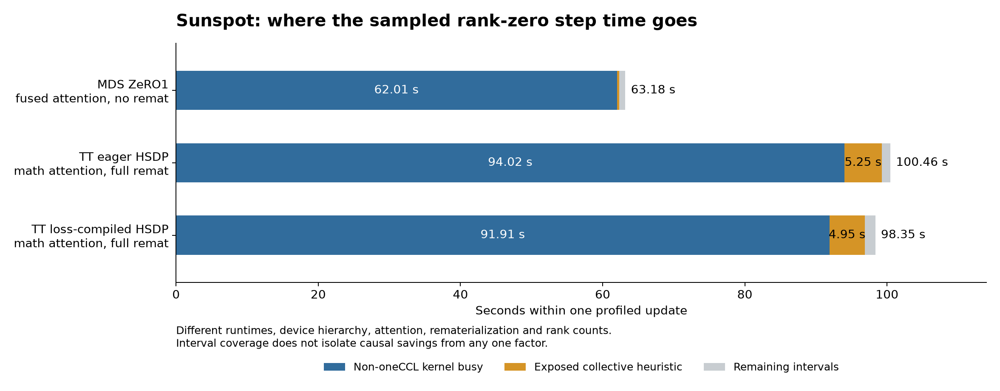

# Why the MDS ZeRO1 run outperformed TorchTitan HSDP

## Finding

The sampled loss-compiled HSDP update takes `98.348 s`; MDS takes `63.180 s`. Of that `35.168 s` difference, `29.901 s` is additional rank-zero time covered by non-oneCCL XPU kernels, and `4.635 s` is additional exposed collective time under the shared heuristic. The kernel-coverage difference is `85.02%` of the sampled step gap. This is interval bookkeeping, not a causal percentage attributable to attention or recomputation.

The executed configurations combine four differences: efficient versus math attention, no rematerialization versus full rematerialization, update-boundary versus microbatch-level sharding communication, and different device hierarchies. The runs establish an observed performance gap; they do not isolate an intrinsic ZeRO1-versus-HSDP speed ratio.



## Profiled time accounting

| Run | Profiled update, s | Non-oneCCL kernel union, s | Exposed collective, s | Remaining intervals, s |
|---|---:|---:|---:|---:|
| MDS ZeRO-1 | 63.180 | 62.011 | 0.310 | 0.860 |
| TT eager HSDP | 100.458 | 94.017 | 5.247 | 1.194 |
| TT compiled HSDP | 98.348 | 91.912 | 4.945 | 1.491 |

The traces are from MDS `12481353`, eager HSDP `12481289`, and loss-compiled HSDP `12481298`. These are one-step profiler durations, not the multi-step steady-state means in the [comparison report](2026-10-23-compile-sharding.md). Every kernel event in each rank-zero trace reports device ID `0`.

Kernel intervals are clipped to the sole `ProfilerStep` and unioned across streams. A collective device kernel is identified by category `kernel` and `oneccl` in its lowercase name, matching the shared analyzer. Exposed collective intervals include matching XCCL host calls and oneCCL kernels, subtracting overlap with other XPU kernels. Host calls can include waiting and synchronization. The remaining column is the step interval outside these two disjoint coverage sets; it has no independent CPU/idle attribution. No all-rank critical path was captured.

## Attention implementation

The actual MDS trace contains `384` efficient SDPA forward calls and `384` efficient backward calls. Its device kernels include Xetla FMHA forward and backward. The two HSDP traces each contain `576` calls to `aten::_scaled_dot_product_attention_math`, with no FMHA kernel names.

The HSDP traces contain FP32 score-matrix operations with inputs `[16,8192,128] x [16,128,8192]` and `[16,8192,8192] x [16,8192,128]`. A `[16,8192,8192]` FP32 score tensor is **4 GiB**. The math attention path therefore performs large dense matrix, softmax, and memory operations that the fused path avoids materializing as a full score tensor. PyTorch documents FP32 intermediates for BF16/FP16 math SDPA in its [SDPA reference](https://docs.pytorch.org/docs/main/generated/torch.nn.functional.scaled_dot_product_attention.html).

`XPUScaledDotProductAttention` in `torchtitan/experiments/ezpz/agpt/__init__.py:228` documents that the requested fused-backend selection is not respected inside FSDP on this path. The run traces corroborate math dispatch. That source comment is evidence of a known limitation; this audit does not reproduce or identify its upstream root cause. Merely requesting `FLASH_ATTENTION` has not been shown to fix it.

## Activation rematerialization

MDS's resolved args are `checkpoint_activations=False`, `deepspeed_activation_checkpointing=False`, and `recompute_granularity=None`. TT logs confirm full rematerialization of all 12 transformer blocks.

The observed attention-forward counts match the executed geometry:

| Run | Layers | Microbatches per rank | Attention forwards per layer/microbatch | Total attention forwards |
|---|---:|---:|---:|---:|
| MDS | 12 | 32 | 1 | 384 |
| TT HSDP | 12 | 24 | 2, forward plus rematerialized forward | 576 |

TT executes twice the attention-forward work per layer/microbatch, using math attention. This count does not mean the whole training step doubles; backward and other operations also contribute. The original TT run without rematerialization OOMed on the math-attention path, so simply disabling remat is not an established recovery at this sequence length.

## Parameter residency and communication cadence

ZeRO1 partitions optimizer state while keeping model parameters replicated. The executed DeepSpeed source defers its optimizer gradient reductions to the final accumulation boundary and gathers updated parameters after the optimizer step. See the [DeepSpeed ZeRO stages](https://deepspeed.readthedocs.io/en/stable/zero3.html) for the stage definitions.

The HSDP configuration is `fsdp_reshard_after_forward=default`, which resolves to true for embeddings and the 12 transformer blocks with PP off. The tail norm/head group keeps its full parameters through backward. `fsdp_defer_gradient_reduction=False`, so only the replica all-reduce is deferred; shard reduce-scatter runs on each of the 24 microbatches.

| HSDP host collective calls per update | Count | Source and observed cadence |
|---|---:|---|
| Parameter all-gather | 648 | 13 units x 2 gathers x 24 microbatches, plus tail x 24 |
| Shard reduce-scatter | 336 | 14 units x 24 microbatches |
| All-reduce | 20 | One at the start; 19 near the final microbatch/step boundary |

Each block and embedding group has 48 all-gather annotations per update; the tail has 24. These exact counts hold for both eager and loss-compiled HSDP. The second parameter gather follows the reshard-after-forward policy; it should not be attributed solely to activation rematerialization.

MDS has three high-level parameter all-gather annotations near the update boundary. Its other 137 all-reduce annotations include per-microbatch cross-entropy and logging operations, so they must not be counted as 137 ZeRO gradient buckets. High-level annotation counts differ from device kernel counts and do not establish communication bytes.

Source pointers: `torchtitan/distributed/fsdp.py:171`, `torchtitan/experiments/ezpz/agpt/parallelize.py:255`, and `torchtitan/training_engine.py:705`. MDS and installed DeepSpeed source locations are recorded in the archived cadence audit.

The communication schedule explains additional collective work and exposure. The exposed-time delta alone is about `4.6-4.9 s` in the two HSDP samples. It does not account for the `35-37 s` sampled step gap, and overlapped communication can still affect concurrent compute.

## Device hierarchy mismatch

The submitted MDS launcher exports `ZE_FLAT_DEVICE_HIERARCHY=FLAT` before loading `oneapi/release/2025.3.1`. That module subsequently sets:

```text
ONEAPI_DEVICE_SELECTOR=level_zero:gpu
ZE_FLAT_DEVICE_HIERARCHY=COMPOSITE
```

There is no later FLAT export in the executed MDS script, and the run reports six visible XPUs per node. TT's pinned helper reasserts FLAT after loading modules. Its traces list twelve devices per node with about `64 GiB` memory each; the launcher uses eight per node.

This establishes different logical-device visibility. Six composite GPU cards versus eight flat tile devices is the likely interpretation, but MDS's trace has empty `deviceProperties`; exact physical mapping and compute capacity equivalence are **unverified**. Dividing throughput by rank count is not a valid hardware normalization here. The GPU hierarchy was therefore an additional comparison confound despite both allocations having two nodes.

## Next controlled measurements

The immediate targets are the TT fused-attention dispatch limitation and module setup that overwrites device hierarchy. A controlled comparison must record the final post-module environment and actual per-rank device properties, then match selected devices, attention implementation, rematerialization, runtime, and data batches.

Three HSDP cadence arms are prepared in the benchmark launcher: `cadence-baseline`, `cadence-defer`, and `cadence-retain`. They hold the existing TT runtime and workload fixed, then enable deferred gradient reduction, followed by `reshard_after_forward=never`. They are **prepared, not submitted or measured**. They would quantify the communication-schedule component, with increased memory residency. They would not isolate attention or hardware visibility. No new compute job was needed for the trace/source findings above.

The numerical disagreement from the original TT runs remains unresolved. This diagnosis does not validate losses, a kernel substitution, or a production configuration change.

## Evidence

- [Machine-readable interval and count results](2026-10-24-zero1-hsdp-diagnosis.json).
- [Exportable PNG](2026-10-24-zero1-hsdp-diagnosis.png), [SVG](2026-10-24-zero1-hsdp-diagnosis.svg).
- [Original performance comparison](2026-10-23-compile-sharding.md).
- [W&B diagnosis artifact](https://wandb.ai/aurora_gpt/torchtitan.ezpz.train/artifacts/benchmark-diagnosis/agpt-zero1-hsdp-diagnosis-20261024/v0), including refined trace counts, analysis scripts, source excerpts, module evidence, and this report.
- Original raw traces remain attached to the five completed online W&B runs listed in the comparison report. MDS source artifact: `mds-agpt2b-sunspot-12481353:v0`.
