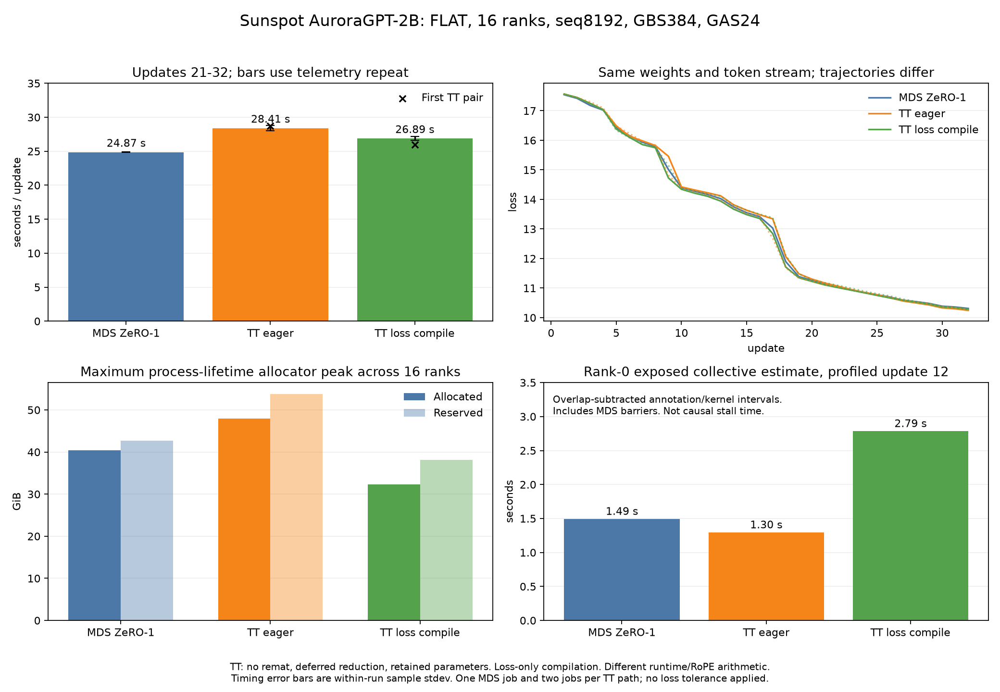

# Sunspot AuroraGPT-2B: Megatron-DeepSpeed versus TorchTitan

Runs completed `2026-10-29`. Report finalized `2026-10-31`.

## Result

`MDS ZeRO1` takes **24.87 s/update**. `TT` eager takes **28.41-28.70 s**;
`TT` with loss compilation takes **25.97-26.89 s**, **4.4-8.1%** slower than
this `MDS` control. Starting parameters and all `32` updates of input data
are verified equal after the required weight representation mapping.
Loss and gradient trajectories differ. Numerical equivalence is not established.

All five measured jobs finished `32/32` updates, saved final checkpoints,
and reached `PBS F`, `Exit_status=0`. There is one `MDS` job and two jobs per
`TT` path. This is a two-node geometry comparison, not a scaling result.
Compilation covers the loss only; full-model compilation was not measured.

Machine-readable measurements: [JSON](2026-10-29-native-checkpoint-closure.json).
Online [W&B analysis and evidence](https://wandb.ai/aurora_gpt/torchtitan.ezpz.train/runs/agpt-native-closure-analysis-20261029).

## Steady-state timing

| Job | Path | Mean s/update | Within-run sample stdev, s | First loss | Last loss | Online run |
|---|---|---:|---:|---:|---:|---|
| `12481576` | MDS ZeRO1 | 24.872761 | 0.020686 | 17.542778 | 10.311508 | [W&B](https://wandb.ai/aurora_gpt/torchtitan.ezpz.train/runs/agpt-mds-baseline-12481576) |
| `12481577` | TT eager, first | 28.700836 | 0.353027 | 17.563419 | 10.276185 | [W&B](https://wandb.ai/aurora_gpt/torchtitan.ezpz.train/runs/agpt-matched-hsdp-no-remat-defer-retain-12481577) |
| `12481580` | TT eager, repeat | 28.412792 | 0.367759 | 17.563419 | 10.246237 | [W&B](https://wandb.ai/aurora_gpt/torchtitan.ezpz.train/runs/agpt-matched-hsdp-no-remat-defer-retain-12481580) |
| `12481578` | TT loss compilation, first | 25.970769 | 0.103789 | 17.563419 | 10.288279 | [W&B](https://wandb.ai/aurora_gpt/torchtitan.ezpz.train/runs/agpt-matched-hsdp-no-remat-defer-retain-compile-12481578) |
| `12481581` | TT loss compilation, repeat | 26.885055 | 0.290336 | 17.563419 | 10.280252 | [W&B](https://wandb.ai/aurora_gpt/torchtitan.ezpz.train/runs/agpt-matched-hsdp-no-remat-defer-retain-compile-12481581) |

Each timing window uses unprofiled updates `21-32`, twelve observations.
`MDS` uses the direct `training/iteration_time` scalar in seconds. `TT`
uses adjacent differences of `time_metrics/end_to_end(s)`, anchored at
update `20`. Update `12` is profiled and excluded from timing. Startup,
checkpoint save and final shutdown are outside this steady-state window.
The full `W&B scan_history` records are preserved; the table is not derived
from sampled UI history or rounded stdout.

Loss compilation reduces eager update time by `9.51%` in the first pair and
`5.38%` in the repeat pair. The compiled run means differ by `0.914286 s`.
The `4.4-8.1%` gap is the range of these two run means against the single
`MDS` mean, not a confidence interval. Within-run sample deviations do not
measure uncertainty across independent jobs.

## Compilation cost and peak memory

| Path and job | Maximum allocated, GiB | Maximum reserved, GiB | Diagnostic coverage |
|---|---:|---:|---|
| `MDS` `12481576` | 40.386580 | 42.726563 | 16/16 ranks |
| Eager `TT` `12481580` | 47.958935 | 53.812500 | 16/16 ranks |
| Loss-compiled `TT` `12481581` | 32.333996 | 38.187500 | 16/16 ranks |

These are maximum process-lifetime allocator peaks across all ranks,
including load, training and save. Allocated and reserved maxima are taken
independently; they need not occur at the same instant. They are allocator
metrics, not total device memory or a sum across ranks. `TT` compilation
reduces allocated peak by `32.58%` relative to eager in the telemetry repeats.

The first `TT` pair's diagnostic wrapper used `finally`, which the trainer's
deliberate `os._exit(0)` bypasses. Their rank-0 W&B peaks agree with the
repeat values, but only the repeats provide all-rank process-lifetime proof.
The corrected wrapper records diagnostics before the hard exit and guards
against forked helpers overwriting the parent-rank file. All `16` repeat
files report `completed_without_exception=true` and `hard_exit_code=0`.

| Compiled-repeat timer | Minimum, s/rank | Median, s/rank | Maximum, s/rank |
|---|---:|---:|---:|
| `_compile.compile_inner` | 16.195741 | 16.500273 | 16.868698 |
| `backward._backward_impl` | 0.462668 | 0.485937 | 0.515018 |

These are the runtime's actual cumulative compiler timers, recorded at
process exit. The eager repeat and `MDS` have no Dynamo graph compilation
timers. Each measured `TT` job uses fresh job-specific node-local `Inductor`
and `Triton` cache paths. Compiled rank `0` records one forward and one
backward compilation record, no local FX/AOT cache hits, and one local FX-cache
miss for each compilation record. The forward record has one AOT-cache
miss; the backward record has zero AOT-cache misses.

Timer keys are nested and ranks execute concurrently. Do not sum keys or
ranks. The table does not measure the end-to-end launch penalty or include
all possible extension build costs. `_compile.compile_inner` includes
frontend/backend work; the separately reported backward timer preserves
its own scope. The full per-rank timer dictionaries and compiler records
are in the job evidence artifact.

## Profiled update 12

| Job | Profiled step, s | XPU kernel union, s | Exposed collective estimate, s | All-gather / reduce-scatter / all-reduce / barrier annotations |
|---|---:|---:|---:|---|
| `12481576` | 24.914988 | 22.986551 | 1.493366 | 3 / 0 / 105 / 2 |
| `12481577` | 28.663520 | 27.094927 | 1.487193 | 15 / 14 / 20 / 0 |
| `12481580` | 28.170714 | 27.107677 | 1.295544 | 15 / 14 / 20 / 0 |
| `12481578` | 27.282662 | 24.708810 | 2.491172 | 15 / 14 / 20 / 0 |
| `12481581` | 27.610610 | 24.658616 | 2.785402 | 15 / 14 / 20 / 0 |

Every trace contains `288` efficient/Flash attention forwards and `288`
backwards (`12` layers x `24` microbatches), with no activation recomputation.
`MDS` reports efficient SDPA; `TT` reports Flash SDPA. The `TT` controls
reduce the original hundreds of per-microbatch collective repetitions to
`15` all-gather and `14` reduce-scatter annotations per update.

Exposure is the rank-0 union of XCCL host annotations and oneCCL kernels,
minus overlap with other XPU kernels. It includes the two `MDS` barrier
annotations. Counts are profiler annotations, not guaranteed wire-call
counts. Device oneCCL barrier kernel events are included in the kernel
union and are distinct from the host barrier annotation column.
This estimate is not causal stall time; one profiled update is not a
steady-state timing sample. Compiled `TT` has higher exposure than eager
in both pairs while completing updates faster. The remaining throughput
gap cannot be assigned exclusively to communication from these traces.
All `16` raw rank traces for each of the four `TT` runs are archived online;
this table analyzes rank `0` only.

## Weight and data equality

The native checkpoint is `global_step138650`, SHA-256
`e37d9ca2c9cb396a3207edf6132815e7a6ad32c247ebe5043782c54a20a69e1c`.
The full audit covers `75` native tensors, `111` logical HF parameter tensors,
all `75` physical DCP keys and **1,986,054,144 parameters**. Native/HF values
match exactly in `BF16` after the required representation mapping. DCP
values are exactly those values promoted to `FP32`, after adapter `Q/K`
basis mapping. All `12` derived RoPE `inv_freq` buffers match the manifest.

The official `HF -> DCP` converter ran as a module from the verified checkout
root. Checkpoint names alone were insufficient: the older October 24 `TT`
checkpoint did not contain the same starting weights as the native control.

The complete stream audit covers **12,288 sequence rows** across `32` updates:
inputs, shifted labels, raw sequence hashes, and rank/microbatch order all
match. Row-payload SHA-256:
`43086288940fadce65e6e690dd7980e1447f18746537c411b0a6c10203f5d1f5`.
Both paths use the same `Books` file list, SHA-256
`c96c8e71f2e6d502dc09e734665e03d3fd241051208d65f35854e34f2dc0aa74`.

## Loss and gradient comparison

All differences below use all `32` updates. No agreement tolerance was
applied. Strict deterministic mode is disabled to retain fused attention;
seed `42` does not imply bitwise reproducibility on this path.

| Loss comparison | Maximum absolute difference | RMS difference |
|---|---:|---:|
| MDS / eager, first | 0.346292 | 0.087216 |
| MDS / compiled, first | 0.349788 | 0.089470 |
| MDS / eager, repeat | 0.447717 | 0.111752 |
| MDS / compiled, repeat | 0.285598 | 0.081563 |
| Eager / eager repeat | 0.659063 | 0.184595 |
| Compiled / compiled repeat | 0.537001 | 0.156901 |
| Eager / compiled, repeats | 0.733315 | 0.186134 |

Same-path repeats also differ, so a single eager/compiled trajectory
comparison cannot isolate compilation as the cause. `MDS` and `TT` retain
different runtimes, `RoPE` arithmetic, reduction order, optimizer kernels
and clipping implementations. Equal weights and token order do not establish
identical forward, backward or optimizer-update arithmetic.

The first pair's logged gradient-norm maximum absolute / RMS differences
are `499.082367 / 122.544485` (`MDS`/eager, maximum at update `8`),
`1207.702179 / 296.523769` (`MDS`/compiled, update `6`), and
`1145.919312 / 256.838910` (eager/compiled, update `6`). Full-precision norm
series for every measured job are included in the JSON. These descriptive
norm comparisons are not an optimizer-equivalence proof.

### Forward-only RoPE phase-cache ablation

Probe `12481579` finished with `Exit_status=0`. It evaluates the first `384`
sequences using `16` unsharded `BF16` replicas and batch size `1`. It changes
the existing `TT ComplexRoPE` cache, then restores it. There is no backward
pass or optimizer update. The token-array SHA-256 is
`fcc07520659aba929190444de90382f549c7370ac4e3d112a907f8f47104a8b6`.

| Probe | Mean loss |
|---|---:|
| Original `FP32` phase cache | 17.561533597608406 |
| Combined `BF16` phase-cache rounding | 17.533865749835968 |
| Restored original cache | 17.561533597608406 |

Rounding positions, inverse frequencies, phase products and sin/cos together
changes loss by `-0.027667847772438`. The complex multiply remains the existing
`FP32` implementation. Restoring the cache restores the probe baseline exactly.
This is causal evidence for this phase-cache intervention within the probe.

The baseline is `0.001885744433` below `TT` training step `1`; the rounded
probe crosses `0.008912265301` below `MDS` training step `1`. The intervention
does not reproduce the `MDS` path or explain the full training trajectory gap.
Raw token values and model checkpoints remain on `Sunspot`; hashes,
provenance, results and source are archived in `W&B`.

## Why the original gap narrowed

The original `97-104 s/update` `TT` configurations combined strict deterministic
math attention, full activation recomputation and communication on each
accumulation microbatch. The original `MDS` launch also differed in device
hierarchy and rank count. Those timings did not isolate the cost of `HSDP`
versus `ZeRO1`.

The October 24 matched-geometry controls measured `37.05 s/update` with
full rematerialization, `31.93 s` without it, `28.55 s` after deferred gradient
reduction plus retained parameters, and `25.26 s` with loss compilation.
Those controls used different starting weights and remain qualified
historical ablations, not same-weight numerical evidence.

The final campaign verifies native parameters and complete input order,
then confirms fused attention, no recomputation and reduced communication
cadence in fresh traces. Retaining parameters and full accumulated gradients
changes the memory tradeoff. These are not default aggressively resharded
`HSDP` results or a general `ZeRO1`/`HSDP` ranking.

Earlier reports: [initial compile/sharding matrix](2026-10-23-compile-sharding.md),
[trace diagnosis](2026-10-24-zero1-hsdp-diagnosis.md),
[matched-geometry controls](2026-10-24-matched-flat-execution.md).

## Execution contract

- Checkout: `/lus/tegu/projects/datascience/foremans/projects/saforem2/torchtitan-agpt-matched-20261024`.
- Immutable base: `5be47f7cfa12cb47d4a774480fe9251fe1e53ff8`; preserve the experiment patch and submitted launcher with each job.
- `TT` runtime: `/lus/tegu/projects/datascience/foremans/venvs/xpu-torch214-fixedlr-v2-20260927`, `torch 2.14.0+xpu`, `oneapi/release/2026.1.0`, matching `SYCL/UR` library shim.
- `MDS` source: isolated `/lus/tegu/home/foremans/.cache/agpt-mds-baseline-20261023/source`, base `b5617bac7b4e2303e738ef7db0307915da905941`, with the archived profiler patch. Runtime: `Megatron-DeepSpeed-aurora_frameworks-2025.3.1` venv, `torch 2.10.0a0+git449b176`, `DeepSpeed 0.18.5`, `oneapi/release/2025.3.1`.
- Native source: `/lus/tegu/home/foremans/.cache/agpt-mds-baseline-20261023/load/global_step138650/mp_rank_00_model_states.pt`.
- Native SHA-256: `e37d9ca2c9cb396a3207edf6132815e7a6ad32c247ebe5043782c54a20a69e1c`.
- Corrected checkpoint: `outputs/agpt-matched-native-weights/dcp/step-0`.
- Conversion: `python -m scripts.checkpoint_conversion.convert_from_hf outputs/agpt-matched-native-weights/hf outputs/agpt-matched-native-weights/dcp/step-0 --model_name torchtitan.experiments.ezpz.agpt --model_flavor 2b-mds`.
- Conversion log: `outputs/agpt-matched-native-weights/convert-hf-to-dcp-retry-20261029.log`.
- Architecture: `12` layers, hidden size `2048`, MLP size `11008`, `16` attention heads, `4` KV heads, padded vocabulary `256000`, maximum positions `131072`, RMSNorm epsilon `1e-5`, BF16 parameters.
- Geometry: `FLAT` device hierarchy, two nodes, `16` ranks, `8` ranks/node, sequence `8192`, `GBS384`, microbatch `1`, accumulation `24`. `MDS`: data parallel degree `16`, `ZeRO1`. `TT`: HSDP replica axis `2` x shard axis `8`, with each shard group on one node.
- Data: `Books`, split `95,5,0`, seed `42`, consumed samples `0`, index horizon `32` updates.
- Optimizer: fresh `AdamW`, constant `LR2e-6`, warmup `0`, betas `(0.9,0.95)`, epsilon `1e-8`, weight decay `0.1`, clipping `1.0`.
- Runs: native-weight canaries, fresh `MDS ZeRO1`, and two runs each of eager and loss-compiled `TT` with deferred gradient reduction and `reshard_after_forward=never`.
- Timing: `32` updates, unprofiled updates `21-32`; trace update `12` outside that window.
- Tracking: online `W&B`, group `agpt-native-closure-sunspot-20261029`; preserve terminal scheduler status, complete logs, histories, raw trace, diagnostics and provenance.

## Evidence and launch failures

`12481573` failed before training: wrapper `--module` collided with child
`--module=ezpz.agpt`, producing `ImportError: No module named ezpz.agpt` and
`PBS Exit_status=143`. Unique `--benchmark-*` options fixed the collision.
Replacement `TT` canary `12481575` and `MDS` canary `12481574` completed
three updates, checkpoint saves and `Exit_status=0`. The `MDS` canary's
index horizon is `3`, not `32`, so its losses are not paired with `TT`.
Its old wrapper also mislabeled successful `SystemExit(0)` as incomplete;
all `16` full-control diagnostics correctly report success.

The native checkpoint conversion audit JSON SHA-256 is
`b1584ff72d8b2fd4f53594cd1bba7b12efb0f6a102bda8407cd315a00fe6bad6`.
The corrected DCP tree has `2` files, `7,944,352,388` bytes, tree hash
`7f605e77c85367aea670e1557737dabbdebfbea7be72b26f69f52f9014616c48`.
Full logs, rank diagnostics, raw traces, configs, source snapshots, histories
and final reports were explicitly approved for upload to online `W&B`.
No training history was rewritten to add posthoc evidence.

Artifacts in `aurora_gpt/torchtitan.ezpz.train`:

- `agpt-native-closure-audits-20261029`: complete parameter/data audit and conversion evidence.
- `agpt-native-closure-job-<jobid>`: job logs, source provenance, histories, selected raw trace, diagnostics and metadata, including failed canary evidence. Successful artifacts are attached to their original online runs.
- `agpt-native-closure-all-rank-traces-<jobid>` for `12481577`, `12481578`, `12481580`, `12481581`: `16` raw traces per artifact.
- `agpt-native-closure-final-20261029`: this report, complete numerical analysis, figure, source and SHA-256 manifest.

The canonical local evidence root is
`outputs/agpt-native-closure-20261029/`. Its `jobs.json` records all nine jobs;
`state.json` records terminal scheduler status. `analysis/` and
`analysis-repeat/` preserve complete W&B histories and timing calculations;
`final/report.json` joins all five measured jobs with rank diagnostics and
trace audits. The final artifact readback records committed state, file counts
and original-run attachments in `wandb-verification.json`.
