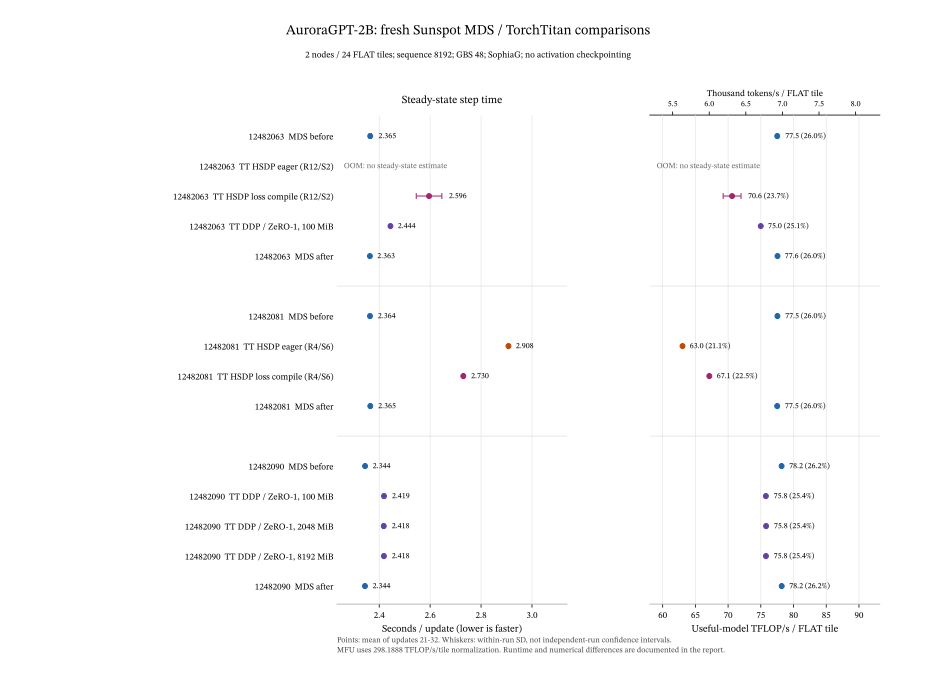

# AuroraGPT-2B: recovered Sunspot MDS/TT comparison

## Results

Fresh `Sunspot` runs completed on `2026-11-02`. Native TT DDP/ZeRO-1 reaches **2.418 s/update** versus **2.344 s/update** for same-allocation MDS controls: about **3.2% slower**. Increasing DDP buckets from `100` to `2048` or `8192 MiB` does not remove that gap.

At the matched HSDP layout (`R4/S6`), loss compilation reduces step time from `2.908` to `2.730 s`, a `6.10%` reduction. Eager HSDP at `R12/S2` runs out of memory; eager at `R4/S6` completes. Only the loss region is compiled in these experiments.

Initial TT parameters and complete consumed token batches are audited. Loss trajectories differ across frameworks and between MDS repeats. **Throughput is close; numerical equivalence remains unproven.** These are short runs on two nodes, not production-scale equivalence.

## Common workload and measurement

`R/S` denotes data-parallel replica/shard degree. One device in every throughput, TFLOPs, and MFU value is **one selected FLAT tile/rank**, not a physical two-tile GPU package.

| Setting | Value |
|---|---|
| Nodes / ranks per node / total ranks | `2 / 12 / 24`, `FLAT` for MDS and TT |
| Model / optimizer | `AuroraGPT-2B / SophiaG`, fresh optimizer state |
| Sequence / microbatch / accumulation / GBS | `8192 / 1 / 2 / 48` |
| Tokens per update / per tile | `393216 / 16384` |
| Updates / seed / activation checkpointing | `32 / 42 / none` |
| Timing window | Updates `21-32`, twelve samples |
| Profiler capture | Update `12` |
| TT native DDP | FP32 local gradient accumulation, BF16 wire and weight all-gather, ZeRO-1 optimizer state |
| HSDP | No reshard after forward, FP32 deferred gradient reduction |
| TT compilation | None or loss region only; no full-model compile result |
| TT runtime | Torch `2.14.0+xpu` |
| MDS runtime | Torch `2.10.0a0+git449b176`, DeepSpeed `0.18.5` |
| W&B | Online, `aurora_gpt/torchtitan.ezpz.train` |

The MDS control selects the historical `BF16_Optimizer` wrapper: Megatron nominal stage `0`, DeepSpeed config stage `1`, FP32 gradient accumulation, and sharded FP32 master/state storage. The run names retain `ds0175`, but the measured DeepSpeed runtime is `0.18.5`. This is a compatibility path, not a literal DeepSpeed `0.17.5` installation or an unqualified modern ZeRO-1 baseline.

All three allocations use immutable TT source [`4831cd2d9`](https://github.com/saforem2/torchtitan/commit/4831cd2d94ad1dca29f1956d5b40e2fee45bdc12) and MDS source `9f407ed9e8e30920e28272daf8cb7db36c211e21`. Launchers use `ezpz launch`. Mandatory dependency/asset and exact-runtime config preflight passed. Runtime, workdir, checkpoint, launcher, source snapshots, and full provenance are archived in W&B. Borrowed runtime environments were not modified.

### Timing, FLOPs, compilation, and memory

TT timing uses adjacent full-precision global-loss TensorBoard event wall times. Independent synchronized per-rank step records cross-check it. MDS uses native `elapsed_time_per_iteration_ms`. Those framework timer boundaries are not proven identical.

`tok/s/tile = 16384 / mean_step_seconds`. Useful-model TFLOPs use `11,186,515,968 FLOPs/token`; MFU divides by the existing report normalization of `298.1888 TFLOP/s/FLAT tile`. These are normalized model-work estimates, not hardware counters. Older production runs with different token budgets, accumulation, rank counts, or FLOP/device conventions require separate normalization; their seconds/update are not directly interchangeable with this workload.

The compiler value is the maximum outer `_compile.compile_inner` timer across ranks. Nested timers and different ranks are not summed. It does not include complete process startup or data loading. TT arms within a job share a compiler cache, so later arms are not independent cold starts. Memory is the maximum process-lifetime allocated/reserved high-water mark across all 24 ranks, not an average over the steady window.

## Initial paired run: `12482063`

| Path / online W&B | Mean s/update | tok/s/tile | Model TFLOP/s/tile | MFU % | Peak allocated / reserved GiB | Outer compile timer max s |
|---|---:|---:|---:|---:|---:|---:|
| [MDS before, historical BF16 wrapper](https://wandb.ai/aurora_gpt/torchtitan.ezpz.train/runs/agpt-mds-zero0-ds0175-sophiag-pair-before-production-acnone-n2x12-12482063) | 2.364592 | 6928.9 | 77.51 | 25.99 | 46.396 / 50.613 | none |
| [TT HSDP R12/S2 eager](https://wandb.ai/aurora_gpt/torchtitan.ezpz.train/runs/agpt-replicated-hsdp-eager-hs12eager-12482063) | OOM after 1 update | -- | -- | -- | incomplete | none |
| [TT HSDP R12/S2 loss compile](https://wandb.ai/aurora_gpt/torchtitan.ezpz.train/runs/agpt-replicated-hsdp-losscompile-hs12loss-12482063) | 2.595684 | 6312.0 | 70.61 | 23.68 | 40.662 / 47.855 | 14.273 |
| [TT native DDP/ZeRO-1, 100 MiB](https://wandb.ai/aurora_gpt/torchtitan.ezpz.train/runs/agpt-replicated-ddp-bf16-losscompile-ddpz1-12482063) | 2.444031 | 6703.7 | 74.99 | 25.15 | 49.064 / 56.820 | 3.013 |
| [MDS after, same control](https://wandb.ai/aurora_gpt/torchtitan.ezpz.train/runs/agpt-mds-zero0-ds0175-sophiag-pair-after-production-acnone-n2x12-12482063) | 2.363333 | 6932.6 | 77.55 | 26.01 | 46.396 / 50.613 | none |

Native DDP/ZeRO-1 is `3.39%` slower than the mean bracketing MDS control. MDS before/after timing drift is `-0.053%`.

The parent job exits `1` because eager HSDP fails during backward after one completed update. XPU requests `7.81 GiB` with `5.58 GiB` free on a `63.98 GiB` tile. The launcher returns `143` after the rank OOM. No user cancellation or PBS pre-run failure caused this result. Its partial run has no steady-state estimate.

The eager W&B run is labelled `finished` despite that OOM. Its `application/status=failed_oom`, application exit, and raw traceback take precedence. Both MDS controls and the other two TT paths complete all `32` updates, with `24/24` finite optimizer witnesses.

All `1,536` consumed input/label/raw-token hash records match across completed arms. Failed eager has `96` matching records and `1,440` missing records. Loaded-parameter audits were disabled in this first performance job after separate canaries passed; its HSDP memory peaks exclude audit materialization.

### Collective visibility

| Path | Trace coverage | Rank-0 exposed collective-kernel ms | Rank-0 idle ms | TT exposed min / median / max ms |
|---|---:|---:|---:|---:|
| MDS before, historical BF16 wrapper | 1/24 ranks | 89.416 | 118.398 | -- |
| TT HSDP R12/S2 loss compile | 24/24 ranks | 221.650 | 210.645 | 167.402 / 214.802 / 256.602 |
| TT native DDP/ZeRO-1, 100 MiB | 24/24 ranks | 187.461 | 85.213 | 101.226 / 168.960 / 204.614 |
| MDS after, same control | 1/24 ranks | 88.223 | 125.029 | -- |

HSDP has more recognized exposed collective activity and idle time than MDS in this capture. Native DDP removes the per-layer parameter all-gather pattern. This supports testing communication layout and scheduling before attributing the entire gap to attention kernels.

### Loss differences versus MDS before

| Path | Max absolute loss difference | RMS loss difference |
|---|---:|---:|
| TT HSDP R12/S2 loss compile | 0.951191 | 0.249758 |
| TT native DDP/ZeRO-1, 100 MiB | 0.304562 | 0.123824 |
| MDS after versus MDS before | 0.756085 | 0.148977 |

[Complete sanitized numerical series and all-rank summaries](2026-11-02-pair-12482063-evidence.json).

## Matched eager/compiled run: `12482081`

Both TT arms use `dp_replicate=4`, `dp_shard=6`. All four phases complete `32` updates, parent exit `0`, with `24/24` finite optimizer witnesses. Each TT arm also passes its own `24/24` exact loaded-parameter audit. All `1,536` consumed input hash records match.

| Path / online W&B | Mean s/update | tok/s/tile | Model TFLOP/s/tile | MFU % | Peak allocated / reserved GiB | Outer compile timer max s |
|---|---:|---:|---:|---:|---:|---:|
| [MDS before, historical BF16 wrapper](https://wandb.ai/aurora_gpt/torchtitan.ezpz.train/runs/agpt-mds-zero0-ds0175-sophiag-pair-before-production-acnone-n2x12-12482081) | 2.363642 | 6931.7 | 77.54 | 26.00 | 46.396 / 50.613 | none |
| [TT HSDP R4/S6 eager](https://wandb.ai/aurora_gpt/torchtitan.ezpz.train/runs/agpt-replicated-hsdp-eager-hs4eager-12482081) | 2.907580 | 5634.9 | 63.04 | 21.14 | 52.896 / 58.064* | none |
| [TT HSDP R4/S6 loss compile](https://wandb.ai/aurora_gpt/torchtitan.ezpz.train/runs/agpt-replicated-hsdp-losscompile-hs4loss-12482081) | 2.730256 | 6000.9 | 67.13 | 22.51 | 37.271 / 42.439* | 15.450 |
| [MDS after, same control](https://wandb.ai/aurora_gpt/torchtitan.ezpz.train/runs/agpt-mds-zero0-ds0175-sophiag-pair-after-production-acnone-n2x12-12482081) | 2.364875 | 6928.1 | 77.50 | 25.99 | 46.396 / 50.613 | none |

Loss compilation reduces mean step time by `6.10%` at this common layout. MDS timing drift is `+0.052%`.

`*` Both TT rows include an opt-in DTensor materialization audit. Their lifetime peaks are not clean measurements of memory change due only to compilation. Current allocated memory returns to its pre-audit value, but allocator-cache effects remain possible.

The allocated-memory difference is `15.62494 GiB`, close to two FP32 vocabulary tensors of shape `[8192, 256000]` (`15.625 GiB`). Eager cross-entropy upcasts predictions to FP32; compiling the loss permits fusion of those casts into loss kernels. This is consistent with the measured difference and the failed `7.81 GiB` allocation in two-shard eager. Attribution of every peak allocation to these tensors remains unverified. See the pinned [`cross_entropy_loss` implementation](https://github.com/saforem2/torchtitan/blob/4831cd2d94ad1dca29f1956d5b40e2fee45bdc12/torchtitan/components/loss.py).

R12/S2 and R4/S6 were measured in separate allocations. The eager/compiled toggle within R4/S6 is a same-allocation comparison; cross-layout timing is not a same-node A/B.

### Loss differences versus MDS before

| Path | Max absolute loss difference | RMS loss difference |
|---|---:|---:|
| TT HSDP R4/S6 eager | 0.685070 | 0.160800 |
| TT HSDP R4/S6 loss compile | 1.803082 | 0.332989 |
| MDS after versus MDS before | 0.646588 | 0.128427 |

[Complete sanitized numerical series and all-rank summaries](2026-11-02-pair-12482081-evidence.json).

## Controlled DDP bucket experiment: `12482090`

Only `native_ddp_bucket_cap_mb` varies between the TT arms. All use native DDP/ZeRO-1 and loss compilation. All five phases complete `32` updates, parent exit `0`, with `24/24` finite optimizer witnesses. Each TT arm passes its own CPU-only `24/24` loaded-parameter audit. All `1,536` input hash records match across all five arms.

| Path / online W&B | Mean s/update | tok/s/tile | Model TFLOP/s/tile | MFU % | Peak allocated / reserved GiB | Outer compile timer max s |
|---|---:|---:|---:|---:|---:|---:|
| [MDS before, historical BF16 wrapper](https://wandb.ai/aurora_gpt/torchtitan.ezpz.train/runs/agpt-mds-zero0-ds0175-sophiag-pair-before-production-acnone-n2x12-12482090) | 2.344350 | 6988.7 | 78.18 | 26.22 | 46.396 / 50.613 | none |
| [TT native DDP/ZeRO-1, 100 MiB](https://wandb.ai/aurora_gpt/torchtitan.ezpz.train/runs/agpt-replicated-ddp-bf16-losscompile-ddpb100-12482090) | 2.418743 | 6773.8 | 75.77 | 25.41 | 49.064 / 56.820 | 16.890 |
| [TT native DDP/ZeRO-1, 2048 MiB](https://wandb.ai/aurora_gpt/torchtitan.ezpz.train/runs/agpt-replicated-ddp-bf16-losscompile-ddpb2048-12482090) | 2.417755 | 6776.5 | 75.81 | 25.42 | 49.064 / 56.820 | 3.102 |
| [TT native DDP/ZeRO-1, 8192 MiB](https://wandb.ai/aurora_gpt/torchtitan.ezpz.train/runs/agpt-replicated-ddp-bf16-losscompile-ddpb8192-12482090) | 2.418387 | 6774.8 | 75.79 | 25.42 | 49.065 / 52.914 | 2.430 |
| [MDS after, same control](https://wandb.ai/aurora_gpt/torchtitan.ezpz.train/runs/agpt-mds-zero0-ds0175-sophiag-pair-after-production-acnone-n2x12-12482090) | 2.343933 | 6990.0 | 78.19 | 26.22 | 46.396 / 50.613 | none |

Mean MDS control time is `2.344142 s`. The three TT gaps are `3.182%`, `3.140%`, and `3.167%`. The fastest observed setting improves over `100 MiB` by only `0.041%`, less than `1 ms/update`. Within-window step-time standard deviations are `3.62`, `3.89`, and `3.36 ms`. This single sequential trial establishes no meaningful throughput benefit from larger buckets; it is not an independent-repeat confidence estimate. MDS timing drift is `-0.0178%`.

DDP logging confirms identical layouts on all `24` ranks:

| Configured cap | Actual rebuilt buckets | FP32 gradient payload bytes, summed across buckets |
|---|---:|---:|
| `100 MiB` | `25` | `7944216576` |
| `2048 MiB` | `3` | `7944216576` |
| `8192 MiB` | `1` | `7944216576` |

The cap does not split an individual parameter tensor. Actual rebuilt buckets can therefore exceed the configured cap. These are local FP32 bucket sizes; the BF16 communication hook changes the wire dtype. At `8192 MiB`, reserved memory falls by `3.906 GiB` relative to `100 MiB`, while allocated peaks stay near `49.064 GiB`.

### Collective visibility

| Path | Trace coverage | Rank-0 exposed collective-kernel ms | Rank-0 idle ms | TT exposed min / median / max ms |
|---|---:|---:|---:|---:|
| MDS before, historical BF16 wrapper | 1/24 ranks | 71.643 | 91.855 | -- |
| TT native DDP/ZeRO-1, 100 MiB | 24/24 ranks | 132.565 | 108.282 | 95.738 / 137.802 / 178.760 |
| TT native DDP/ZeRO-1, 2048 MiB | 24/24 ranks | 103.473 | 65.164 | 76.766 / 98.612 / 145.450 |
| TT native DDP/ZeRO-1, 8192 MiB | 24/24 ranks | 98.117 | 66.467 | 76.657 / 99.813 / 142.302 |
| MDS after, same control | 1/24 ranks | 70.926 | 92.900 | -- |

Median recognized exposed collective-kernel time falls from `137.802` to `98.612` / `99.813 ms`, while steady-state update time stays near `2.418 s`. Bucket granularity alone therefore does not explain the remaining gap. The captured profiler update is outside the timing window, and interval overlap is not a causal attribution of the update-time difference.

The remaining measured difference is about `74 ms/update`. Compute arithmetic, optimizer scheduling, weight synchronization, and the different PyTorch runtimes remain variables. This experiment does not identify which one accounts for that difference. A phase-level compute/optimizer comparison under matched arithmetic is the next discriminating experiment.

### Loss differences versus MDS before

| Path | Max absolute loss difference | RMS loss difference |
|---|---:|---:|
| TT native DDP/ZeRO-1, 100 MiB | 1.622599 | 0.322823 |
| TT native DDP/ZeRO-1, 2048 MiB | 1.076362 | 0.202200 |
| TT native DDP/ZeRO-1, 8192 MiB | 0.343705 | 0.098852 |
| MDS after versus MDS before | 0.631402 | 0.210264 |

Changing bucket grouping can change floating-point reduction order. These loss differences neither establish nor disprove convergence equivalence. No equivalence tolerance has been applied.

[Complete sanitized numerical series, bucket layouts, and all-rank summaries](2026-11-02-pair-12482090-evidence.json).

## Numerical and profiling limits

Native TT DDP uses autocast with FP32 embedding, RMSNorm, and residual tensors. That differs from uniform BF16 model compute. Exact initial parameter values and matching consumed batches do not prove identical forward/backward arithmetic, gradients, or optimizer updates.

MDS before/after loss trajectories also differ, despite stable timing. The canaries use `debug.deterministic=false`; seed `42` alone does not establish repeatability. Bitwise loss/gradient agreement and representative convergence remain unresolved.

All TT completed arms have raw traces from `24/24` ranks; MDS captures rank `0` only. Each rank is analyzed independently. Device activity includes kernels, copies, and memsets. Recognized collective names contain `oneCCL` or `ccl::`; exposure is their interval union minus overlap with other device activity. CPU collective annotations are not added to device time. Unsynchronized ranks are never merged into a global timeline. These metrics are not complete wire/network measurements or causal stall estimates.

## Recovery and launch repairs

`12481979` starts once on two Sunspot nodes and completes two 10-step debug arms with scheduler exit `0`. This proves application execution after the November 1 incident. Support ticket `REQ-17196` supplies no site root cause or repair details.

Native canaries `12482057`, `12482058`, and `12482059`, followed by HSDP canary `12482062`, each complete `32` updates with `24/24` finite optimizer witnesses. Every TT rank exactly matches all `111` adapted parameter keys (`1,986,054,144` elements) before training. HSDP uses a separate materialization audit; native DDP audits loaded CPU values before device transfer.

The first two canaries were duplicate submissions after delayed login preflight. Their missing shared PBS stdout parent was corrected; both then reached application execution on their second attempts. The third uses job-specific PBS stdout and starts once. The stdout defect is verified; the precise cause of scheduler `-3` remains unverified. No jobs were cancelled.

MDS preflight finds missing `click/core.py` in its borrowed helper environment's Click `8.3.1`. An isolated no-dependency overlay installs the same version. The exact installed Click CLI dry-run also reproduces the dropped Python/entrypoint payload at a nested `--`. Removing the inner separator preserves the payload; real MDS training then completes in all six controls. Source commit `4831cd2d9` contains the narrow experimental launcher fix and overlay provenance capture. The source branch is published for review and is not merged into `ezpz`.

## Evidence

Every performance table links to its original online training runs. Per-run campaign-evidence artifacts retain logs, raw traces, rank diagnostics, configs, input hashes, and immutable source snapshots. Full private provenance, complete fetched bundles, parent phase logs, analysis scripts, final figures, and this report are retained by the [dedicated W&B analysis run](https://wandb.ai/aurora_gpt/torchtitan.ezpz.train/runs/agpt-postrecovery-report-20261102). That archival run executes no training. Public JSON contains sanitized numerical evidence; full source manifests and provenance remain in W&B.

All fetched files are size/SHA-verified: `528` in `12482063`, `494` in `12482081`, and `624` in `12482090`. W&B artifacts are checked for committed state, with downloaded diagnostics/audits/traces checked against their manifests. Failed eager evidence is retained alongside completed arms.

- [Pre-recovery audit and numerical limits](2026-11-01-handoff-audit.md)
- [Same-allocation protocol](2026-11-01-paired-performance.md)
- [Original startup incident](2026-11-01-startup-incident.md)
