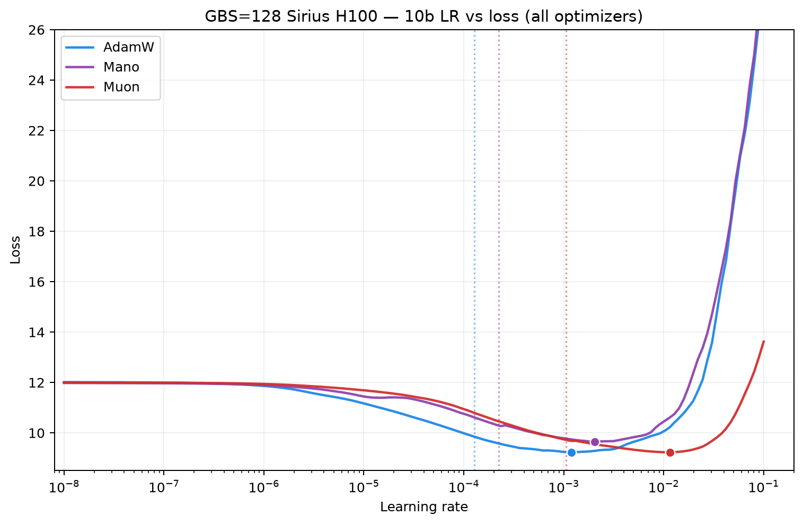
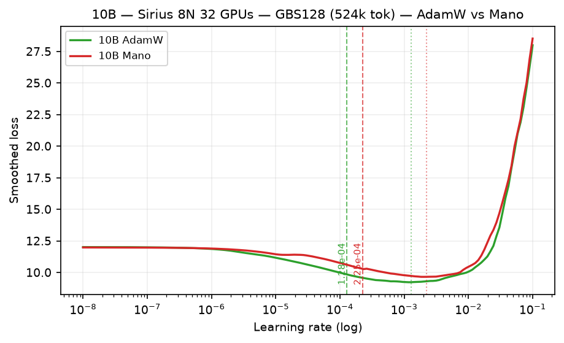

# LR Finder -- agpt 10B OLMo-tokenizer

Learning-rate evidence for the 9.48B-parameter `agpt_10b_olmo2tok` / `agpt_10b_olmo3_polaris` model.
For the campaign-wide records, see the
[GBS=6144 report](../2026-09-18-olmo2tok-ladder-gbs6144-nexteval.md) and the
[GBS=128 Sirius report](../2026-11-12-olmo3-gbs128-sirius.md).
For methodology and acceptance criteria, see the
[LR-finder methodology](../../README.md).

## Status

**Production LR: open.**
| optimizer | evidence | interpretation |
|---|---|---|
| AdamW | `12478509`, 100/100 points over `1e-6`–`1e-3` | observed basin minimum `4.64e-4`; detector `4.16e-5` is a 10× safety heuristic, not a measured optimum |
| SophiaG | `12478569`, 100/100 points over `1.66e-6`–`1.66e-4` | loss minimum is the final sample; detector `3.24e-7` is below the sampled range and is not defensible |
## OLMo-3-1K GBS=128 on Sirius (2026-11-11 to 2026-11-15) -- direct input to Polaris chain

Same model family at the **Polaris production batch** (GBS=128, 524k tok = 128 x 4096, 8N 32 GPUs Sirius H100).
Exponential sweep `1e-08 -> 1e-01`, 150 steps, `mult=1.114243`, `fraction=0.15` of `steps=1000`.
Seven of eight arms exited 0; `33543` SophiaG failed at 25/150 (fingerprint mismatch). `33450` Mano resumed from step 72/150 walltime kill via step-90 checkpoint.

| optimizer | job | suggested (blow-up) | min loss at LR | interpretation |
|---|---|---:|---:|---|
| **AdamW** | `33430` | **1.28e-04** (`1.28e-03`) | `9.23` at `1.19e-03` | deeper descent |
| **Mano** | `33450` | **2.25e-04** (`2.25e-03`) | `9.66` at `2.04e-03` | **76% higher than AdamW -- inversion vs 5B** |
| **Muon** | `33543` | **1.06e-03** (`1.06e-02`) | `9.23` at `1.15e-02` | **8.3x higher than 5B AdamW, ties AdamW minimum** |
| **SophiaG** | `33543` | incomplete | -- | 25/150, fingerprint mismatch -- no CSV |

Polaris 10B recommendation at GBS=128: **AdamW 1.28e-04 / Mano 2.25e-04 / Muon 1.06e-03** (see [GBS128 report](../2026-11-12-olmo3-gbs128-sirius.md)). SophiaG incomplete at this batch.
Artifacts: [`sirius-33430-10b-adamw-150.csv`](../data/2026-11-12-olmo3-gbs128-sirius/sirius-33430-10b-adamw-150.csv) |
[`sirius-33450-10b-mano-150.csv`](../data/2026-11-12-olmo3-gbs128-sirius/sirius-33450-10b-mano-150.csv) |
[`sirius-33543-10b-muon-150.csv`](../data/2026-11-12-olmo3-gbs128-sirius/sirius-33543-10b-muon-150.csv) | [manifest](../data/2026-11-12-olmo3-gbs128-sirius/README.md)

### Fixed-LR candidate table (GBS=128, validated LRs)

Four validated LRs feed the gated fixed-LR matrix (all blow-up/10):

| model | optimizer | fixed-LR candidate | blow-up LR | evidence job | status |
|---|---|---:|---:|---|---|
| 5B | AdamW | **2.48e-04** | `2.48e-03` | `33429` | validated |
| 5B | Muon | **6.54e-04** | `6.54e-03` | `33542` | validated |
| 10B | AdamW | **1.28e-04** | `1.28e-03` | `33430` | validated |
| 10B | Muon | **1.06e-03** | `1.06e-02` | `33543` | validated |

See [GBS128 report](../2026-11-12-olmo3-gbs128-sirius.md) and
[agpt index](../README.md#recommended-learning-rates) for full context.
Muon's basin is 2.6x-8.3x higher than AdamW at this batch.

### SophiaG degenerate -- excluded from fixed-LR matrix

SophiaG is **excluded** from the fixed-LR matrix until re-measurement:

- **5B** (`33542`, 150/150): detector reports two candidates -- `7.00e-07`
  (`7.00e-06` blow-up) and `1.01e-04` (`1.01e-03` blow-up). The first is a noise
  crossing in the nearly-flat early basin (loss barely moved at that LR); the
  second sits near the shallow observed minimum (`10.00` at `1.06e-03`) but the
  curve barely descends there (12.00 -> 10.00 vs AdamW 12.01 -> 9.38) and is too
  shallow to trust. The `~1e-5` noise and `~1e-3` drift span two decades, so
  detector output is untrusted -- neither LR can be safely fixed.
- **10B** (`33543`, 25/150): incomplete -- `trajectory_fingerprint mismatch`
  (`a002...` vs `8d2e...` in `checkpoints/lr_finder_10b_sophiag`) from a stale
  checkpoint on auto-retry. No complete CSV; fingerprint bug, not a measurement.

Do not use SophiaG for production at GBS=128 without a clean re-run.

### GBS scaling law -- placeholder (gated)

The GBS scaling law (GBS 32 / 512 / 2048) extends the GBS=128 baseline to test
how optimal LR varies with batch size. It is **not yet measured**.

**Completion gate:** all 6 ladder jobs (5B x {32,512,2048} + 10B x {32,512,2048})
must reach **PBS Exit 0** and record **LRF_STEPS** rows (150/150) with finite
loss and **no** `trajectory_fingerprint mismatch` error. Dispatch: see
`submit_lr_finder_gbs_ladder_sirius.sh` (5B) and
`submit_lr_finder_gbs_ladder_10b_sirius.sh` (10B) -- both `GBS_VALUES=(32 512 2048)`.
Preflight: `preflight_lrf_gbs.sh` / `preflight_lrf_gbs_10b.sh`.

Until the gate passes, treat the fixed-LR matrix as GBS=128 only; do not
extrapolate optimal LR across batch sizes. When the ladder completes, this
section will be replaced with the fitted scaling-law table and figures.

## GBS=6144 evidence (2026-09-18 campaign, separate batch)

## AdamW

Job `12478509` completed with finite artifacts. Its loss minimum occurred at
`4.64e-4`, then the curve rose. The published `4.16e-5` was the detector
crossing divided by 10. The curve supports a basin near several `1e-4`; it does
not by itself establish a constant production LR.

A fixed-LR validation should follow the 5B matrix once that workflow is
classified, using identical initialization and enough updates to expose
sustained instability.

## SophiaG

Job `12478569` completed 100 points, but the loss was still decreasing at the
upper endpoint `1.66e-4` (the exact minimum is sample 100/100, with only three
local upticks across the curve). The fine window therefore did not bracket the
basin.
A replacement must start from the same clean initialization and extend above
`1.66e-4`; independently initialized points must not be appended to this curve.

## Artifacts

- [10B AdamW CSV](../data/2026-09-24-olmo2tok-gbs6144-verified/sunspot-12478509-10b-adamw-fine.csv)
- [10B SophiaG CSV](../data/2026-09-24-olmo2tok-gbs6144-verified/sunspot-12478569-10b-sophiag-fine.csv)
- [Evidence manifest](../data/2026-09-24-olmo2tok-gbs6144-verified/README.md)

The CSV schema does not encode gradient or optimizer-update health. Terminal
logs and fresh artifacts remain part of the acceptance contract.
