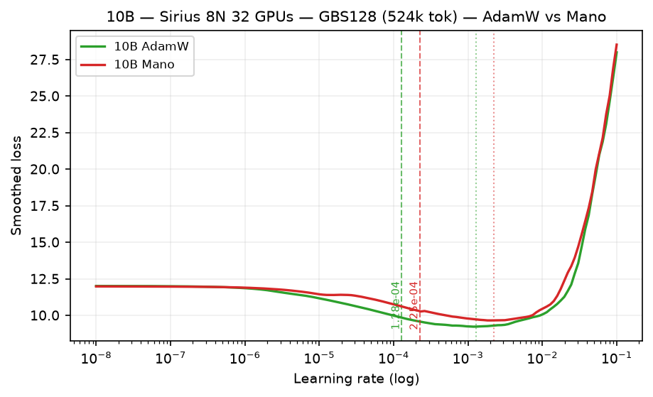

# LR Finder -- agpt 10B OLMo-tokenizer

Learning-rate evidence for the 9.48B-parameter `agpt_10b_olmo2tok` / `agpt_10b_olmo3_polaris` model.
For the campaign-wide records, see the
[GBS=6144 report](../2026-09-18-olmo2tok-ladder-gbs6144-nexteval.md) and the
[GBS=128 Sirius report](../2026-11-12-olmo3-gbs128-sirius.md).
For methodology and acceptance criteria, see the
[LR-finder methodology](../../README.md).

## Status

**Production LR: open.**

| optimizer | evidence | interpretation |
|---|---|---|
| AdamW | `12478509`, 100/100 points over `1e-6`–`1e-3` | observed basin minimum `4.64e-4`; detector `4.16e-5` is a 10× safety heuristic, not a measured optimum |
| SophiaG | `12478569`, 100/100 points over `1.66e-6`–`1.66e-4` | loss minimum is the final sample; detector `3.24e-7` is below the sampled range and is not defensible |
## OLMo-3-1K GBS=128 on Sirius (2026-11-11 to 2026-11-12) -- direct input to Polaris chain

Same model family at the **Polaris production batch** (GBS=128, 524k tok = 128 x 4096, 8N 32 GPUs Sirius H100).
Exponential sweep `1e-08 -> 1e-01`, 150 steps, `mult=1.114243`, `fraction=0.15` of `steps=1000`.
Both arms exited 0; `33450` Mano resumed from step 72/150 walltime kill via step-90 checkpoint.

| optimizer | job | suggested (blow-up) | min loss at LR | interpretation |
|---|---|---:|---:|---|
| **AdamW** | `33430` | **1.28e-04** (`1.28e-03`) | `9.23` at `1.19e-03` | deeper descent |
| **Mano** | `33450` | **2.25e-04** (`2.25e-03`) | `9.66` at `2.04e-03` | **76% higher than AdamW -- inversion vs 5B** |

Polaris 10B recommendation at GBS=128: **AdamW 1.28e-04 / Mano 2.25e-04** (see [GBS128 report](../2026-11-12-olmo3-gbs128-sirius.md)).
Artifacts: [`sirius-33430-10b-adamw-150.csv`](../data/2026-11-12-olmo3-gbs128-sirius/sirius-33430-10b-adamw-150.csv) |
[`sirius-33450-10b-mano-150.csv`](../data/2026-11-12-olmo3-gbs128-sirius/sirius-33450-10b-mano-150.csv) | [manifest](../data/2026-11-12-olmo3-gbs128-sirius/README.md)

## GBS=6144 evidence (2026-09-18 campaign, separate batch)

## AdamW

Job `12478509` completed with finite artifacts. Its loss minimum occurred at
`4.64e-4`, then the curve rose. The published `4.16e-5` was the detector
crossing divided by 10. The curve supports a basin near several `1e-4`; it does
not by itself establish a constant production LR.

A fixed-LR validation should follow the 5B matrix once that workflow is
classified, using identical initialization and enough updates to expose
sustained instability.

## SophiaG

Job `12478569` completed 100 points, but the loss was still decreasing at the
upper endpoint `1.66e-4` (the exact minimum is sample 100/100, with only three
local upticks across the curve). The fine window therefore did not bracket the
basin.
A replacement must start from the same clean initialization and extend above
`1.66e-4`; independently initialized points must not be appended to this curve.

## Artifacts

- [10B AdamW CSV](../data/2026-09-24-olmo2tok-gbs6144-verified/sunspot-12478509-10b-adamw-fine.csv)
- [10B SophiaG CSV](../data/2026-09-24-olmo2tok-gbs6144-verified/sunspot-12478569-10b-sophiag-fine.csv)
- [Evidence manifest](../data/2026-09-24-olmo2tok-gbs6144-verified/README.md)

The CSV schema does not encode gradient or optimizer-update health. Terminal
logs and fresh artifacts remain part of the acceptance contract.
