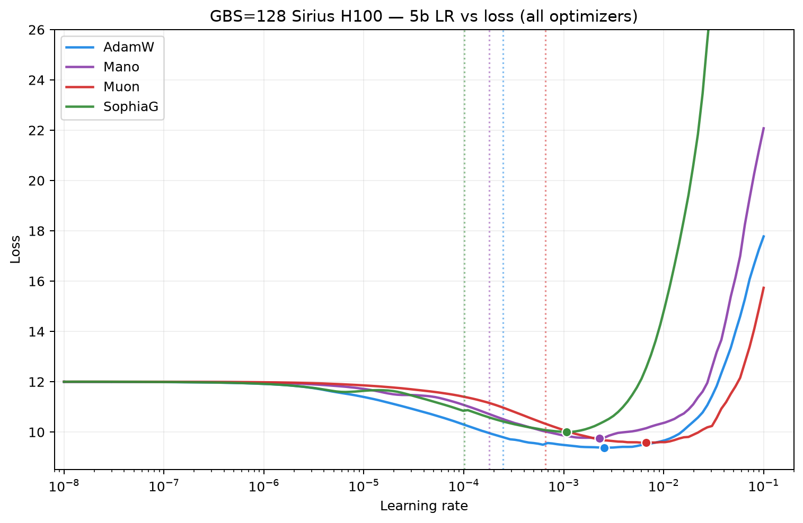
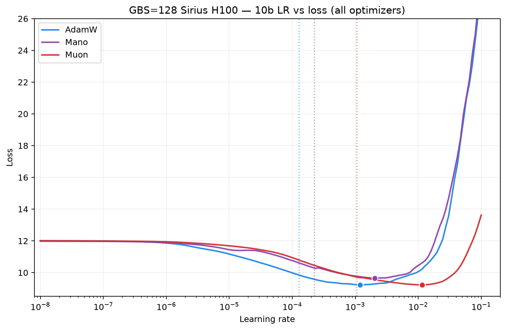
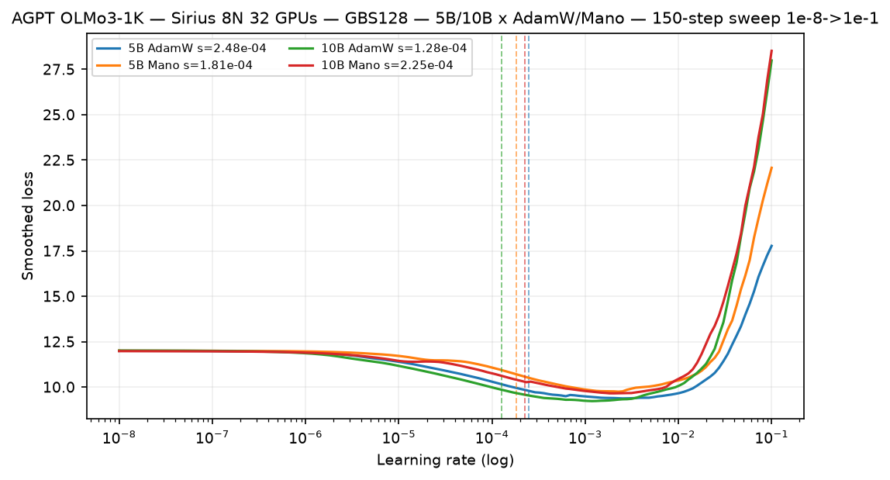
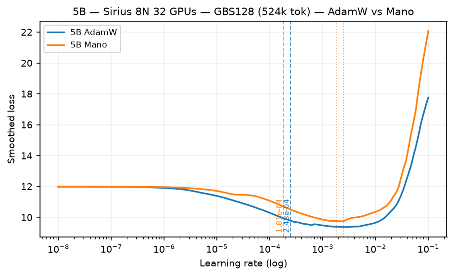
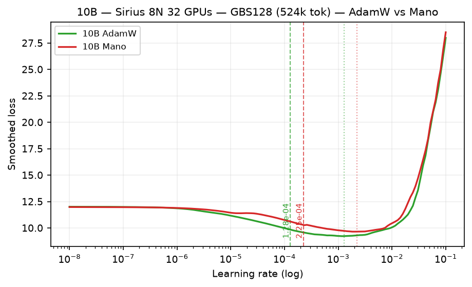
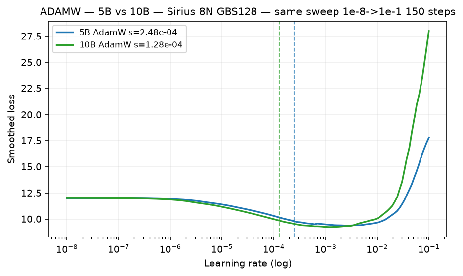
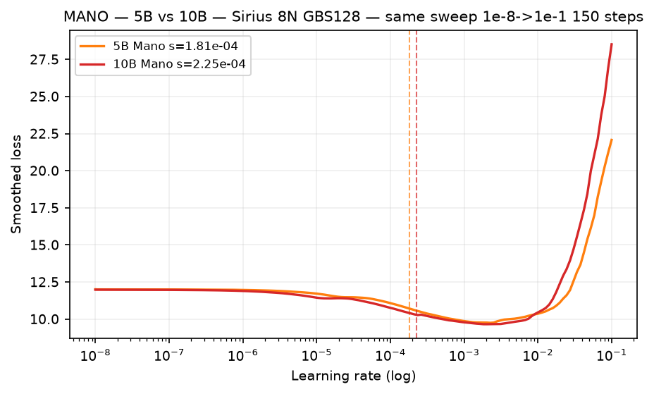

# OLMo-3-vocab LR finder: 5B / 10B at GBS=128 on Sirius (OLMo-3-1K)

**Campaign:** 2026-11-11 through 2026-11-15
**Machine:** Sirius (NVIDIA H100, `sirius-pbs-0001`)
**Models:** `agpt_5b_olmo3_polaris` (4.8B) / `agpt_10b_olmo3_polaris` (9.8B) -- OLMo-3-1K tokenizer
**Sequence length:** 4096
**Global batch size:** 128 sequences / 524,288 tokens (`--training.num-tokens-per-train-step 524288`, `LBS=4096, GBS/LBS 128/1`)
**Parallelism:** 8N 32 GPUs (`NNODES=8`, `world_size=32`, `dp_replicate=32`, `tp=1`) -- FSDP2
**Sweep:** exponential `1e-08 -> 1e-01` (ratio `1e7`, log span 7 decades), **150 steps**, `mult=1.114243`, `fraction=0.15` of `training.steps=1000`
**Configs:** `agpt_5b_olmo2tok_smoke` / `agpt_10b_olmo2tok_smoke` via `torchtitan/experiments/ezpz/scripts/submit_agpt_olmo3_sirius.sh` (`VENV=.venv`, CUDA graph)
**Queue:** `workq` 06:00:00, `filesystems=home:tegu`

This is the first OLMo-3-1K finder at a *small* production-like batch (GBS=128 = 0.5M tok). The prior OLMo-3 ladder (`2026-09-18`) ran GBS=6144 (25M tok). The Polaris `7832130` 18N chain is also GBS=128, so these numbers feed it directly. The **Nov 14-15 extension** adds Muon and SophiaG at the same batch.

## Result

Seven of eight planned arms completed 150/150 points, exited 0, wrote finite LR/loss CSVs, and logged detector outputs. 10B SophiaG failed at step 25/150 with a `trajectory_fingerprint` mismatch (stale `lr_finder_10b_sophiag` checkpoint from a different trajectory) and has no complete CSV. No NaN, no sharding errors -- FSDP2 on 32 GPUs is clean at this batch.

| model | AdamW suggested (blow-up) | Mano suggested (blow-up) | Muon suggested (blow-up) | SophiaG | note |
|---|---:|---:|---:|---|---|
| **5B** | **2.48e-04** (`2.48e-03`) | **1.81e-04** (`1.81e-03`) | **6.54e-04** (`6.54e-03`) | degenerate | SophiaG detector finds `7.0e-06` (noise) + `1.01e-03`; neither trustworthy |
| **10B** | **1.28e-04** (`1.28e-03`) | **2.25e-04** (`2.25e-03`) | **1.06e-03** (`1.06e-02`) | incomplete | failed at 25/150, fingerprint mismatch |

Detector is `blow-up / 10` (Smith/Gugger `find_optimal_lr` derivative crossing, see [methodology](../README.md)). Suggested = blow-up divided by 10; the raw blow-up LR is also reported for safety-margin reasoning.

Inversions vs 5B AdamW: 5B Mano **27% lower**, 5B Muon **2.6x higher**; 10B Mano **76% higher**, 10B Muon **8.3x higher** than their 5B AdamW baseline. Muon tolerates substantially higher LR at this batch.

For Polaris `agpt_5b_olmo3_polaris` / `agpt_10b_olmo3_polaris` at the same GBS=128, use:
- **5B** AdamW `2.48e-04`, Mano `1.81e-04`, **Muon `6.54e-04`** -- SophiaG not recommended
- **10B** AdamW `1.28e-04`, Mano `2.25e-04`, **Muon `1.06e-03`** -- SophiaG incomplete
with the usual 10x margin already applied (i.e. blow-up is 10x above).

## Curves

### All optimizers by model (GBS=128, including Nov 14-15)

| 5B -- AdamW / Mano / Muon / SophiaG | 10B -- AdamW / Mano / Muon (no SophiaG) |
|---|---|
|  |  |

Muon (red) sits far right: its basin extends to `6.5e-03` (5B) / `1.1e-02` (10B), well beyond AdamW/Mano. SophiaG 5B (green) shows the degenerate early noise at `7e-06` and the real shallow basin around `1e-03`; its second candidate `1.01e-04` is not recommended. Dashed verticals are detector-suggested LRs (`blow-up / 10`). Markers are minima. SophiaG 10B has no complete curve.

### All four original trajectories (AdamW + Mano only)

AdamW descends deeper than Mano at both sizes (lower minimum loss), but Mano at 10B sustains a slightly later blow-up (higher optimal LR). The loss depth is sweep-cumulative (each step does a real optimizer update then raises LR) -- only the *LR* at the minimum / blow-up is comparable, not the absolute loss value.

### 5B: AdamW vs Mano (original pair)

- **5B AdamW:** min loss `9.38` at `2.53e-03`, detector blow-up `2.48e-03` -> suggested `2.48e-04`.
- **5B Mano:** min loss `9.75` at `2.27e-03`, detector blow-up `1.81e-03` -> suggested `1.81e-04`.
- AdamW reaches ~0.37 lower loss than Mano at the bottom (12.01->9.38 vs 11.98->9.75).

### 5B: Muon and SophiaG (extension)

- **5B Muon:** min loss `9.57` at `6.69e-03`, detector blow-up `6.54e-03` -> suggested `6.54e-04` (job `33542`, PBS log `lr_finder_5b_muon_33542.log`, reconstructed from terminal sweep; LR below `1e-07` restored from schedule).
- **5B SophiaG:** `degenerate`. Detector returns two minima `7.00e-06` and `1.01e-03`. The early `7.00e-06` is noise in the nearly-flat early basin (`suggested 7.00e-07` is not the real basin). The second candidate's suggested `1.01e-04` sits near the observed minimum `10.00 at 1.06e-03`, but the loss barely descends there (12.00->10.00 vs AdamW 12.01->9.38) and the curve is too shallow to trust.

### 10B: AdamW vs Mano (original pair)

- **10B AdamW:** min loss `9.23` at `1.19e-03`, detector blow-up `1.28e-03` -> suggested `1.28e-04`.
- **10B Mano:** min loss `9.66` at `2.04e-03`, detector blow-up `2.25e-03` -> suggested `2.25e-04`.
- Again AdamW descends deeper, but Mano's blow-up is *later* (higher LR) -- the inversion.

### 10B: Muon (extension) -- SophiaG incomplete

- **10B Muon:** min loss `9.23` at `1.15e-02`, detector blow-up `1.06e-02` -> suggested `1.06e-03` (job `33543`, exit 0, 150/150).
- **10B SophiaG:** incomplete -- ran `25/150` steps then hit `trajectory_fingerprint` mismatch (`a002...` vs `8d2e...` in `checkpoints/lr_finder_10b_sophiag`) on auto-retry. No complete CSV; needs clean re-run with fresh checkpoint dir.

### Cross-size by optimizer

| AdamW 5B vs 10B | Mano 5B vs 10B |
|---|---|
|  |  |

- **AdamW:** 10B suggested LR is **48% lower** than 5B (1.28e-04 vs 2.48e-04) — expected model-size scaling (larger model → lower LR).
- **Mano:** 10B suggested LR is **24% higher** than 5B (2.25e-04 vs 1.81e-04) — opposite scaling; Mano becomes relatively more LR-tolerant at 10B for this batch/vocab.

## Evidence

Immutable source artifacts live in
[`data/2026-11-12-olmo3-gbs128-sirius/`](./data/2026-11-12-olmo3-gbs128-sirius/README.md).
The CSV schema records `learning_rate,loss,timestamp,job_id,hostname,world_size,global_batch_size,seq_len`; the LR-vs-loss plot is derived from the same CSV. Terminal log excerpts confirm the detector outputs and exit 0.

| job | model | optimizer | rows | sampled LR range | SHA-256 | suggested (blow-up) |
|---:|---|---|---:|---|---:|---|
| `33429` | 5B | AdamW | 150 | `1e-08`-`1e-01` | `0d0415f5...` | `2.48e-04` (`2.48e-03`) |
| `33429` | 5B | Mano | 150 | `1e-08`-`1e-01` | `c1f54cb3...` | `1.81e-04` (`1.81e-03`) |
| `33542` | 5B | Muon | 150 | `1e-08`-`1e-01` | `0e982695...` | `6.54e-04` (`6.54e-03`) |
| `33542` | 5B | SophiaG | 150 | `1e-08`-`1e-01` | `6227da95...` | degenerate -- `7.00e-07` (`7.00e-06`) + `1.01e-04` (`1.01e-03`) |
| `33430` | 10B | AdamW | 150 | `1e-08`-`1e-01` | `c05d3b41...` | `1.28e-04` (`1.28e-03`) |
| `33450` | 10B | Mano | 150 | `1e-08`-`1e-01` | `9ff98d35...` | `2.25e-04` (`2.25e-03`) |
| `33543` | 10B | Muon | 150 | `1e-08`-`1e-01` | `a61b482f...` | `1.06e-03` (`1.06e-02`) |
| `33543` | 10B | SophiaG | 25/150 | -- | -- | **incomplete** -- fingerprint mismatch, no complete CSV |

Full hashes in the data README. 5B Muon was reconstructed from its PBS log (LR below `1e-07` restored from schedule); all others are direct Sirius CSVs. The earlier report listed two hashes for 10B (reconstructed 2-col vs full 8-col); now all entries are full 8-col Sirius CSVs.

### Scheduler / parallelism notes

- `world_size=32` (8N × 4 GPUs/node on Sirius), `global_batch_size=524288` tokens (128 × 4096), `seq_len=4096`.
- `--checkpoint.async-mode disabled` for the finder; `--lr_finder.fraction 0.15` (150 of 1000 steps swept, rest of config unused).
- No warmup (`warmup_fraction 0.0`, `beta 0.98`, `smooth_frac 0.05`).
- `--checkpoint.interval 5` with `keep_last 20` (10B Muon: 10 retained; 10B SophiaG: 5 retained before failure).

### What this does not prove

- This is a **finder**, not a fixed-LR training validation. Suggested LRs are detector heuristics; sustained training may prefer a different point in the basin. A fixed-LR matrix is still needed for production commitment.
- SophiaG at this batch is **not validated**: 5B is degenerate, 10B incomplete. Do not use either for production without a clean re-run.
- GBS=128 is small for the 80B production batch (GBS=6144); these LRs are for the 5B/10B GBS=128 Polaris chain only. Do not extrapolate to 30B/80B at large batch -- see [`agpt/README.md`](README.md) for the batch-dependence warning.

## Related

- Prior OLMo-3-vocab ladder at GBS=6144 (same tokenizer family): [`2026-09-18-olmo2tok-ladder-gbs6144-nexteval.md`](2026-09-18-olmo2tok-ladder-gbs6144-nexteval.md) — 5B/10B/30B on Sunspot/Sirius, open recommendations.
- Per-model pages: [`agpt 5B`](5b/README.md) · [`agpt 10B`](10b/README.md) — updated below with this GBS=128 evidence.
- Methodology: [`LR-finder methodology`](../README.md).
