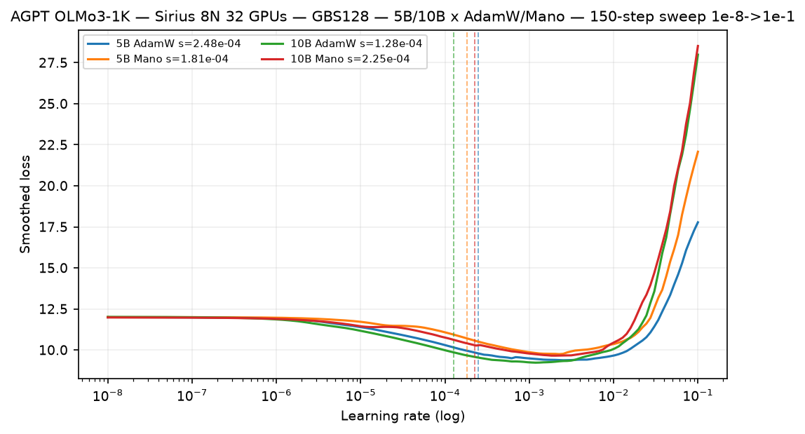
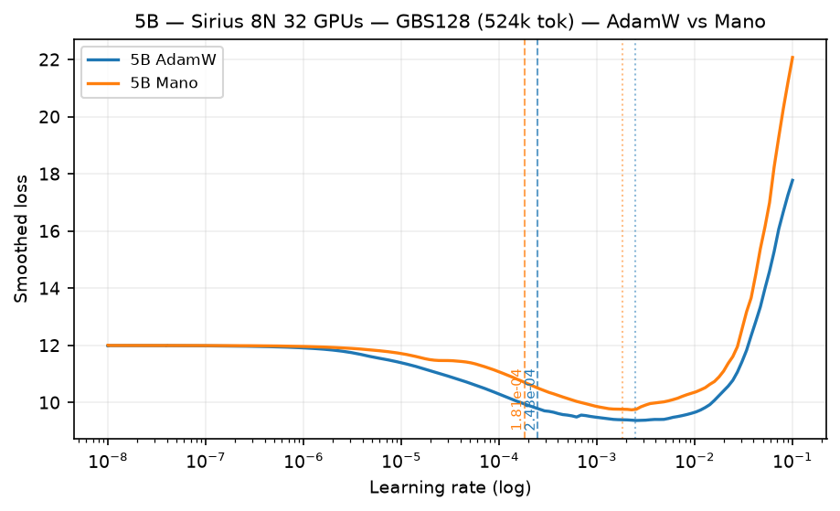
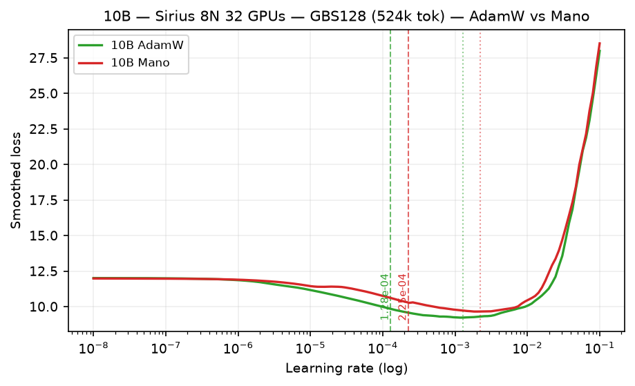
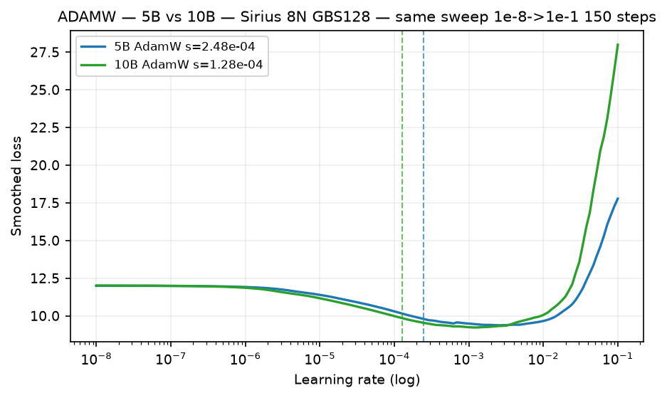
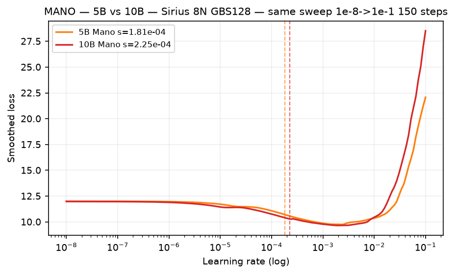

# OLMo-3-vocab LR finder: 5B / 10B at GBS=128 on Sirius (OLMo-3-1K)

**Campaign:** 2026-11-11 through 2026-11-12
**Machine:** Sirius (NVIDIA H100, `sirius-pbs-0001`)
**Models:** `agpt_5b_olmo3_polaris` (4.8B) / `agpt_10b_olmo3_polaris` (9.8B) — OLMo-3-1K tokenizer
**Sequence length:** 4096
**Global batch size:** 128 sequences / 524,288 tokens (`--training.num-tokens-per-train-step 524288`, `LBS=4096, GBS/LBS 128/1`)
**Parallelism:** 8N 32 GPUs (`NNODES=8`, `world_size=32`, `dp_replicate=32`, `tp=1`) — FSDP2
**Sweep:** exponential `1e-08 -> 1e-01` (ratio `1e7`, log span 7 decades), **150 steps**, `mult=1.114243`, `fraction=0.15` of `training.steps=1000`
**Configs:** `agpt_5b_olmo2tok_smoke` / `agpt_10b_olmo2tok_smoke` via `torchtitan/experiments/ezpz/scripts/submit_agpt_olmo3_sirius.sh` (`VENV=.venv`, CUDA graph)
**Queue:** `workq` 06:00:00, `filesystems=home:tegu`

This is the first OLMo-3-1K finder at a *small* production-like batch (GBS=128 = 0.5M tok). The prior OLMo-3 ladder (`2026-09-18`) ran GBS=6144 (25M tok). The Polaris `7832130` 18N chain is also GBS=128, so these numbers feed it directly.

## Result

All four arms completed 150/150 points, exited 0, wrote finite LR/loss CSVs + NPZ, and logged detector outputs. No blow-up detection failures, no NaN, no sharding errors — FSDP2 on 32 GPUs is clean at this batch.

| model | AdamW suggested (blow-up) | Mano suggested (blow-up) | inversion |
|---|---:|---:|---|
| **5B** | **2.48e-04** (`2.48e-03`) | **1.81e-04** (`1.81e-03`) | Mano **27% lower** than AdamW |
| **10B** | **1.28e-04** (`1.28e-03`) | **2.25e-04** (`2.25e-03`) | Mano **76% higher** than AdamW |

Detector is `blow-up / 10` (Smith/Gugger `find_optimal_lr` derivative crossing, see [methodology](../README.md)). Suggested = blow-up divided by 10; the raw blow-up LR is also reported for safety-margin reasoning.

The headline is the **10B inversion**: at 5B Mano is more conservative (lower suggested LR), at 10B Mano tolerates *higher* LR than AdamW. Do not extrapolate 5B's ordering to 10B+.

For Polaris `agpt_5b_olmo3_polaris` / `agpt_10b_olmo3_polaris` at the same GBS=128, use:
- **5B AdamW 2.48e-04**, **5B Mano 1.81e-04**
- **10B AdamW 1.28e-04**, **10B Mano 2.25e-04**
with the usual 10x margin already applied (i.e. blow-up is 10x above).

## Curves

### All four trajectories (same sweep window)

AdamW descends deeper than Mano at both sizes (lower minimum loss), but Mano at 10B sustains a slightly later blow-up (higher optimal LR). The loss depth is sweep-cumulative (each step does a real optimizer update then raises LR) — only the *LR* at the minimum / blow-up is comparable, not the absolute loss value.

### 5B: AdamW vs Mano

- **5B AdamW:** min loss `9.38` at `2.53e-03`, detector blow-up `2.48e-03` → suggested `2.48e-04`.
- **5B Mano:** min loss `9.75` at `2.27e-03`, detector blow-up `1.81e-03` → suggested `1.81e-04`.
- AdamW reaches ~0.37 lower loss than Mano at the bottom (12.01→9.38 vs 11.98→9.75).

### 10B: AdamW vs Mano

- **10B AdamW:** min loss `9.23` at `1.19e-03`, detector blow-up `1.28e-03` → suggested `1.28e-04`.
- **10B Mano:** min loss `9.66` at `2.04e-03`, detector blow-up `2.25e-03` → suggested `2.25e-04`.
- Again AdamW descends deeper, but Mano's blow-up is *later* (higher LR) — the inversion.

### Cross-size by optimizer

| AdamW 5B vs 10B | Mano 5B vs 10B |
|---|---|
|  |  |

- **AdamW:** 10B suggested LR is **48% lower** than 5B (1.28e-04 vs 2.48e-04) — expected model-size scaling (larger model → lower LR).
- **Mano:** 10B suggested LR is **24% higher** than 5B (2.25e-04 vs 1.81e-04) — opposite scaling; Mano becomes relatively more LR-tolerant at 10B for this batch/vocab.

## Evidence

Immutable source artifacts live in
[`data/2026-11-12-olmo3-gbs128-sirius/`](./data/2026-11-12-olmo3-gbs128-sirius/README.md).
The CSV schema records `learning_rate,loss,timestamp,job_id,hostname,world_size,global_batch_size,seq_len`; the LR-vs-loss plot is derived from the same CSV. Terminal log excerpts confirm the detector outputs and exit 0.

| job | model | optimizer | rows | sampled LR range | SHA-256 | suggested (blow-up) |
|---:|---|---|---:|---|---:|---|
| `33429` | 5B | AdamW | 150 | `1e-08`–`1e-01` | `0d0415f5...` | `2.48e-04` (`2.48e-03`) |
| `33429` | 5B | Mano | 150 | `1e-08`–`1e-01` | `c1f54cb3...` | `1.81e-04` (`1.81e-03`) |
| `33430` | 10B | AdamW | 150 | `1e-08`–`1e-01` | `96961fdd...` / `c05d3b41...` | `1.28e-04` (`1.28e-03`) |
| `33450` | 10B | Mano | 150 | `1e-08`–`1e-01` | `6ab40c41...` / `9ff98d35...` | `2.25e-04` (`2.25e-03`) |

SHA prefixes are from the canonical CSVs; full hashes in `.sha256` and the data README. The two 10B hashes per row correspond to the reconstructed 2-column CSV vs the full 8-column Sirius CSV (same `lr,loss` content; the full CSV retains `timestamp,job_id,hostname,world_size,global_batch_size,seq_len`).

### Scheduler / parallelism notes

- `world_size=32` (8N × 4 GPUs/node on Sirius), `global_batch_size=524288` tokens (128 × 4096), `seq_len=4096`.
- `--checkpoint.async-mode disabled` for the finder; `--lr_finder.fraction 0.15` (150 of 1000 steps swept, rest of config unused).
- No warmup (`warmup_fraction 0.0`, `beta 0.98`, `smooth_frac 0.05`).

### What this does not prove

- This is a **finder**, not a fixed-LR training validation. Suggested LRs are detector heuristics; sustained training may prefer a different point in the basin. A fixed-LR matrix (like `5b/README.md`'s `1e-4..1e-2` chain) is still needed for production commitment.
- Only **AdamW and Mano** were swept. SophiaG/Muon were not run at this batch; the Sep GBS=6144 campaign excluded them on XPU for 80B-scale reasons that do not necessarily apply here, but they remain open.
- GBS=128 is small for the 80B production batch (GBS=6144); these LRs are for the 5B/10B GBS=128 Polaris chain only. Do not extrapolate to 30B/80B at large batch — see [`agpt/README.md`](agpt/README.md) for the batch-dependence warning.

## Related

- Prior OLMo-3-vocab ladder at GBS=6144 (same tokenizer family): [`2026-09-18-olmo2tok-ladder-gbs6144-nexteval.md`](2026-09-18-olmo2tok-ladder-gbs6144-nexteval.md) — 5B/10B/30B on Sunspot/Sirius, open recommendations.
- Per-model pages: [`agpt 5B`](5b/README.md) · [`agpt 10B`](10b/README.md) — updated below with this GBS=128 evidence.
- Methodology: [`LR-finder methodology`](../README.md).
