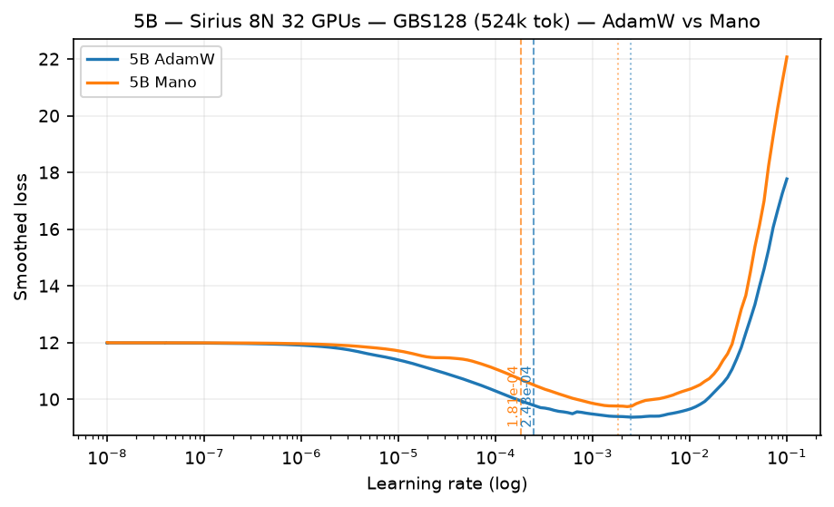

# LR Finder — agpt 5B OLMo-tokenizer

Learning-rate evidence for the 4.64B-parameter `agpt_5b_olmo2tok` / `agpt_5b_olmo3_polaris` model.
For the campaign-wide records, see the
[GBS=6144 report](../2026-09-18-olmo2tok-ladder-gbs6144-nexteval.md) and the
[GBS=128 Sirius report](../2026-11-12-olmo3-gbs128-sirius.md).
For methodology and acceptance criteria, see the
[LR-finder methodology](../../README.md).

## Status

**Production LR: open.**

The complete AdamW and SophiaG sweeps are real evidence, but their original
detector outputs are not final production recommendations. Fixed-LR training
is now validating sustained behavior.

| optimizer | evidence | interpretation |
|---|---|---|
| AdamW | `12478508`, 100/100 points over `1e-6`–`1e-3` | observed basin minimum `6.58e-4`; detector `7.17e-5` is crossing ÷ 10, not a measured optimum |
| SophiaG | `12478624`, 100/100 points over `2.8e-6`–`2.8e-3` | old `7.04e-7` selected a pre-basin noise crossing; corrected candidate `4.96e-5` remains unvalidated |
## OLMo-3-1K GBS=128 on Sirius (2026-11-11 to 2026-11-12) -- direct input to Polaris chain

Same model family at the **Polaris production batch** (GBS=128, 524k tok = 128 x 4096, 8N 32 GPUs Sirius H100).
Exponential sweep `1e-08 -> 1e-01`, 150 steps, `mult=1.114243`, `fraction=0.15` of `steps=1000`.
Both arms exited 0 with finite losses throughout; FSDP2 on 32 GPUs clean.

| optimizer | job | suggested (blow-up) | min loss at LR | interpretation |
|---|---|---:|---:|---|
| **AdamW** | `33429` | **2.48e-04** (`2.48e-03`) | `9.38` at `2.53e-03` | deeper descent than Mano |
| **Mano** | `33429` | **1.81e-04** (`1.81e-03`) | `9.75` at `2.27e-03` | 27% lower than AdamW at 5B |

Cross-size AdamW comparison (5B vs 10B): [10B page](../10b/README.md) shows the inversion -- 10B Mano is 76% *higher* than AdamW.
Polaris 5B recommendation at GBS=128: **AdamW 2.48e-04 / Mano 1.81e-04** (blow-up/10, see [GBS128 report](../2026-11-12-olmo3-gbs128-sirius.md)).
Artifacts: [`sirius-33429-5b-adamw-150.csv`](../data/2026-11-12-olmo3-gbs128-sirius/sirius-33429-5b-adamw-150.csv) |
[`sirius-33429-5b-mano-150.csv`](../data/2026-11-12-olmo3-gbs128-sirius/sirius-33429-5b-mano-150.csv) | [manifest](../data/2026-11-12-olmo3-gbs128-sirius/README.md)

## GBS=6144 evidence (2026-09-18 campaign, separate batch)

## AdamW fixed-LR validation

The coarse sweep `12478444` tested through `1e-1`. LRs `1e-3` and `1e-2`
remained finite for their individual sweep updates, but that does not prove
sustained fixed-LR stability.

The matched 100-update matrices use identical fresh initialization, seed 42,
GBS=6144, sequence length 4096, LBS=2/GAS=4, `dp_shard=4`,
`dp_replicate=192`, five warmup steps, then constant LR.

The first matrix completed 100 finite updates at every LR. Every arm wrote a
false `INVALID` marker because the wrapper searched stdout for an update-ratio
metric emitted only to W&B/TensorBoard. These are valid training trajectories
after post-hoc checks of scheduler exit, finite loss/gradients, and real
updates; the marker itself is not evidence of failure.

| LR | first job | step-100 loss | interpretation |
|---:|---:|---:|---|
| `1e-4` | `12478890` | `5.70206` | best endpoint in the first matrix |
| `3e-4` | `12478891` | `6.23678` | finite, worse than `1e-4` |
| `1e-3` | `12478892` | `6.89134` | finite, worse than `1e-4` |
| `3e-3` | `12478893` | `7.15027` | finite, worse than `1e-4` |
| `1e-2` | `12478894` | `14.96573` | finite but clearly unstable/poor |

The canonical rerun uses jobs `12478895`–`12478899`. Job `12478895`
reproduced the `1e-4` endpoint exactly: loss `5.70206` after 100 updates. It
also produced a fresh 768-shard checkpoint and real update-ratio evidence
(median `7.05e-5`, max `1.76e-3`). This is a deterministic confirmation, not
an independent seed replicate. The other rerun arms are monitored separately;
their live scheduler state belongs in the dashboard rather than this durable
page.

A winner requires 100 finite updates, finite gradients, real parameter-change
evidence, a fresh checkpoint, and comparison of the full matched trajectory.

### 2026-09-29 lower-control replacement chain

The copied isolated venv has a stale `bin/ezpz` shebang, so the replacement
wrapper invokes `ezpz.cli:main` through the verified interpreter instead of the
console script. Runtime/parser preflight `12479007` finished with exit 0.
Five-step `1e-4` canary `12479008` completed five finite updates and exited 0;
its inline `INVALID` marker repeats the known stdout-only predicate defect, while
W&B run [`qxkw7004`](https://wandb.ai/aurora_gpt/torchtitan.ezpz.train/runs/qxkw7004)
contains the optimizer diagnostics. The `3e-5` arm `12479009` completed 100 steps with PBS exit 0 under
W&B run [`wzpyq053`](https://wandb.ai/aurora_gpt/torchtitan.ezpz.train/runs/wzpyq053).
The `1e-5` arm `12479010` also completed 100 finite updates with PBS exit 0,
final loss `6.84922`, final gradient norm `0.5989`, and a fresh 768-shard DCP
checkpoint. Post-hoc validation found real parameter updates (median update
ratio `7.77e-6`, maximum `1.82e-4`) and wrote `VALIDATED_POSTHOC`.

These jobs close the missing lower-LR controls. Final selection still requires
comparison of the complete matched trajectories rather than endpoint loss alone.

## Artifacts

- [5B AdamW CSV](../data/2026-09-24-olmo2tok-gbs6144-verified/sunspot-12478508-5b-adamw-fine.csv)
- [5B SophiaG CSV](../data/2026-09-24-olmo2tok-gbs6144-verified/sunspot-12478624-5b-sophiag-fine.csv)
- [Evidence manifest](../data/2026-09-24-olmo2tok-gbs6144-verified/README.md)

The CSV schema does not encode gradient or optimizer-update health. Terminal
logs and fresh artifacts remain part of the acceptance contract.
