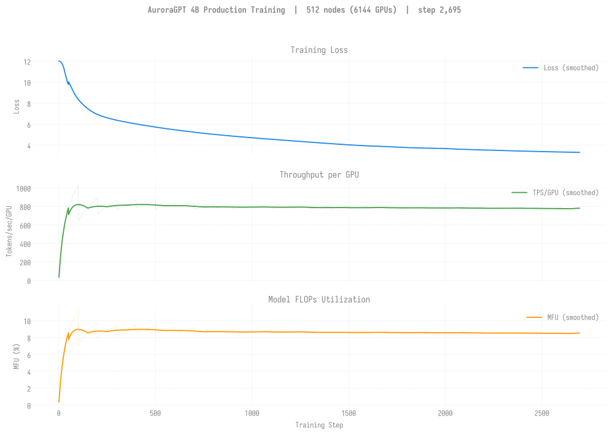
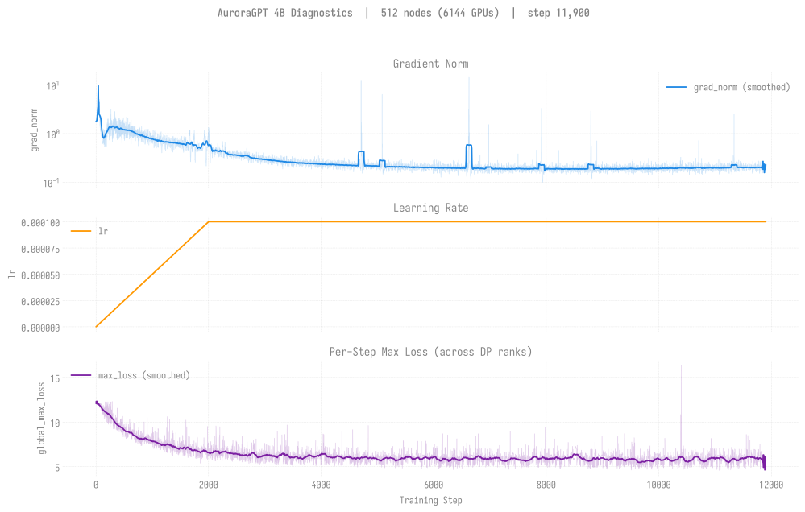
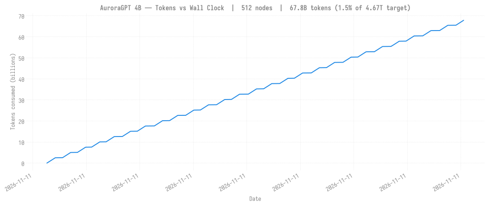
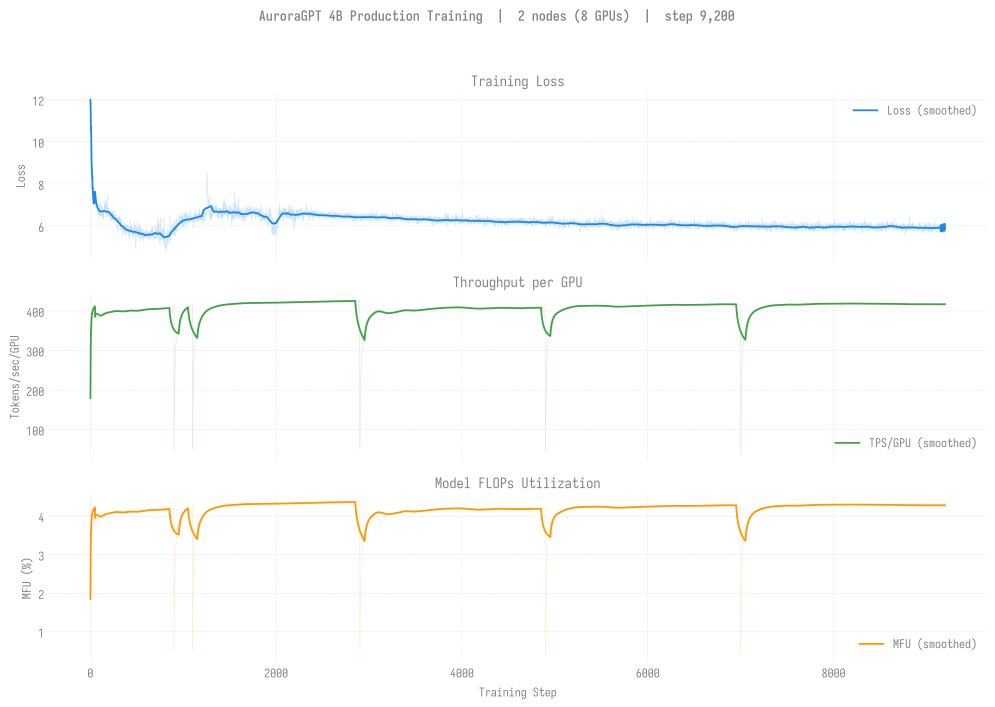
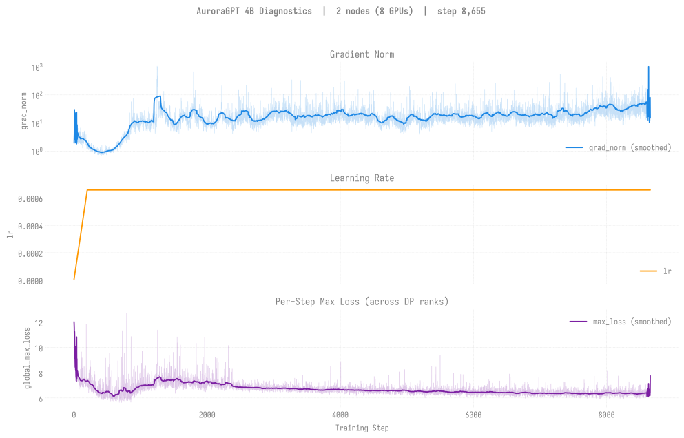
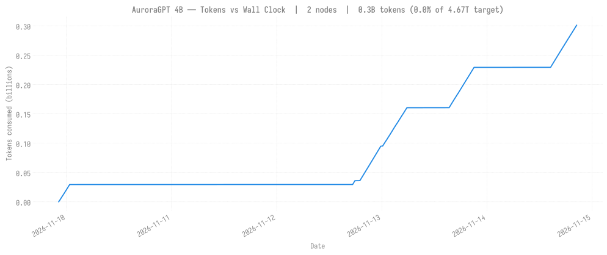

# Production Training — agpt 4B (4.64B), OLMo-3 tokenizer, 4K

> **Last updated:** 2026-11-17. Aurora steps and checkpoints read from disk and
> logs at 03:40 UTC; Sirius/Polaris queue state from `qstat -x` at 03:18 UTC.

The agpt-v2 4.64B model: `5b_olmo2tok` geometry (dim 3072, 40 layers, 24 heads,
8 KV heads, vocab 100352), OLMo-3 tokenizer (byte-identical to OLMo-2-1124-7B),
4096-token sequences, text tokenized on the fly by Grain. Some pages and job
names use the geometry name `5b`. Its 9.48B twin is [agpt 10B](../10b/README.md).

## Status

| Machine | Config | Shape | Head | Tokens | Now |
|---|---|---|---|---:|---|
| Aurora | `agpt_v2_4b_4k_olmo_mix` | 512N, GBS 6144 | `step-20700` | -- | stalled: per-chain `9091877` (Nov 18-19) never got past loading `step-20700` |
| Sirius | `agpt_5b_olmo3_polaris` | 2N, GBS 8 | `step-7400` | 0.24B | finished, `33525` (`Exit_status=-29`, walltime) |
| Polaris | `agpt_5b_olmo3_polaris` | 16N / 32N | -- | -- | queued since Nov 9, `7832130` / `7832131` |

Tokens are steps x GBS x 4096. The full olmo-mix-1124 budget is 4.67T.

## Aurora: 512N on raw olmo-mix-1124

| | |
|---|---|
| Config | `agpt_v2_4b_4k_olmo_mix` (`5b_olmo2tok_dp12`: hidden 8448 so FSDP shards evenly at 12 tiles/node) |
| Data | raw olmo-mix-1124 JSON, 24576 files, manifest `olmo-mix-dp6144.txt` (sorted) |
| Optimizer | AdamW `1e-4`, 2000 warmup |
| Batch | GBS 6144 x 4096 = 25.2M tokens/step |
| Checkpoints | `/flare/AuroraGPT/foremans/projects/saforem2/torchtitan-ezpz/outputs/checkpoints/agpt-v2-4b-4k-olmo-mix-n512-20261109/` (26, every 100) |
| W&B | `uqrribs1` |

| Job | Dates | Steps | Loss | Throughput | Outcome |
|---|---|---|---|---|---|
| `9053470` seat 3 (umbrella) | Nov 9-11 | `1 -> 2698` | `12.002 -> 3.311` | 781 TPS/GPU, 8.5% MFU, ~5 s/step | Training when PBS killed the umbrella for a GPU fault in another seat. Saved `step-2600`. |
| `9076358` | Nov 14-15 | `2601 -> 8989` | `-> 2.727` | 1677 s load, 297 s saves | 12h walltime (`Exit_status=-29`). Saved `step-8900`. |
| `9094039` seat 3 (umbrella) | Nov 16- | `8901 -> 11800+` | `-> 2.672` | 6-7% MFU | First reload ran 9305 s with no output; the 3600 s idle watchdog killed it (`rc=124`). The relaunch loaded alone and trained from 8979 at 23:17 UTC. Saved through `step-11700` as of 03:40 UTC. [Write-up](../../2026-11-16-umbrella-9094039.md). |
| `9091877` (per-chain) | Nov 18-19 | none | -- | -- | 12h walltime. 10 attempts, no training step logged: all stalled loading `step-20700`; 6 hit the idle watchdog (`rc=124`, ~5000 s), 3 ended `rc=143` (~2600 s). Head stays `step-20700`. |

Umbrella `9053470` (the manual 24h umbrella: 2088 nodes on `large`, launched in a
placeholder job named `test.sh`) trained this seat from 03:07:54 to 07:01:41 UTC on
Nov 11, ~5.2 s/step. Logged values from
`logs/multi-autoretry-9053470/trainer-3-v2-4b-n512-attempt-1.console.log`:

| Step | Tokens | Loss | Grad norm | TPS/GPU | MFU |
|---:|---:|---:|---:|---:|---:|
| 1 | 0.0B | 12.00226 | 1.7622 | 33 | 0.37% |
| 10 | 0.3B | 11.92056 | 1.8139 | 276 | 3.02% |
| 50 | 1.3B | 9.77805 | 4.3188 | 783 | 8.56% |
| 250 | 6.3B | 6.58036 | 1.7553 | 798 | 8.73% |
| 500 | 12.6B | 5.71695 | 1.2996 | 858 | 9.38% |
| 750 | 18.9B | 5.11663 | 0.7835 | 793 | 8.68% |
| 1,000 | 25.2B | 4.69840 | 0.8445 | 809 | 8.85% |
| 1,250 | 31.5B | 4.34715 | 0.5923 | 792 | 8.66% |
| 1,500 | 37.7B | 4.01323 | 0.5855 | 799 | 8.74% |
| 1,750 | 44.0B | 3.85628 | 0.8479 | 783 | 8.57% |
| 2,000 | 50.3B | 3.73506 | 1.3205 | 791 | 8.65% |
| 2,250 | 56.6B | 3.53816 | 0.6027 | 779 | 8.52% |
| 2,500 | 62.9B | 3.38003 | 0.3251 | 785 | 8.59% |
| 2,698 | 67.9B | 3.31110 | 0.3888 | 781 | 8.54% |

Memory 36.5 GiB per tile (57%). Steps 1-10 include compile and warmup.

Charts (Aurora 512N, from W&B via `plot_production_wandb.py`):

- It stays on the **sorted** manifest to keep its data cursor valid. With that
  order every rank reads all of its non-code files before any code: no starcoder
  until each rank's fourth file. New runs use the seed-0 shuffle
  ([umbrella write-up, item 6](../../2026-11-11-umbrella-2088n.md#6-the-v2-manifests-are-sorted-which-makes-the-mix-a-curriculum)).
- Before the per-node `/tmp` HF cache fix, 6144 ranks waited ~6 min on one
  `/home` datasets lock before step 1. `seat-autoretry-20261111.pbs` sets
  `HF_DATASETS_CACHE=/tmp/...`.

## Sirius: 2N hedge on Dolma

Started while Polaris could not place its jobs. Full detail:
[Sirius hedge report](../sirius-olmo3-5b-10b.md).

| | |
|---|---|
| Config | `agpt_5b_olmo3_polaris` (Dolma raw JSON via Grain) |
| Optimizer | AdamW `6.58e-4` (GBS=6144 finder basin) |
| Batch | 8 GPUs, GBS 8 x 4096 = 32.8K tokens/step |
| Checkpoints | `checkpoints/agpt-5b_olmo3_polaris-n2-gbs8` (every 100) |

| Job | Steps | Loss | Outcome |
|---|---|---|---|
| `33471` | `2900 -> 5058` | `6.50 -> 6.14` | walltime |
| `33487` | `5058 -> 7092` | `6.05 -> 5.90` | walltime; last good checkpoint `step-7000` |
| `33525` | `7001 -> 8551` | `5.97 -> 6.07` | ended Nov 14 18:43; `-A datascience` |

Earlier legs: `33376` (1-1080), `33456` (901-1260), `33460` (1101-3029). W&B runs, in
resume order: `jm4cpxhz`, `senzi8jf`, `byb8t878`, `8fq5kilz`, `dorbtxse`, `m1vycznv`.
Throughput 409-416 TPS/GPU, MFU 4.2-4.27%.

**Not converging like Aurora.** Grad norm sits at 10-100 from step ~800 on (Aurora
512N: ~1 falling to 0.35), and loss has stayed near 6 for 5,000 steps (Aurora: 3.3
at step 2,698). Inference, not tested: the LR `6.58e-4` comes from the GBS=6144
finder basin and this run uses GBS 8.

Charts (Sirius 2N, from W&B via `plot_production_wandb.py`):

## Polaris: 16N and 32N on Dolma

Same config as Sirius. `submit_agpt_olmo3_polaris.sh` sets GBS = GPUs (LBS 1,
GAS 1): 64 at 16N (262K tokens/step), 128 at 32N (524K). Both jobs have waited
since Nov 9 with `Not enough free nodes`.

## Links

- [Umbrella `9053470` and per-seat resubmission](../../2026-11-11-umbrella-2088n.md)
- [Sirius hedge report](../sirius-olmo3-5b-10b.md)
- [LR finder, 5B](../../../experiments/lr-finder/agpt/5b/README.md)
- [`submit_agpt_olmo3_polaris.sh`](../../../../scripts/submit_agpt_olmo3_polaris.sh),
  [`seat-autoretry-20261111.pbs`](../../../../submit/aurora/seat-autoretry-20261111.pbs)
